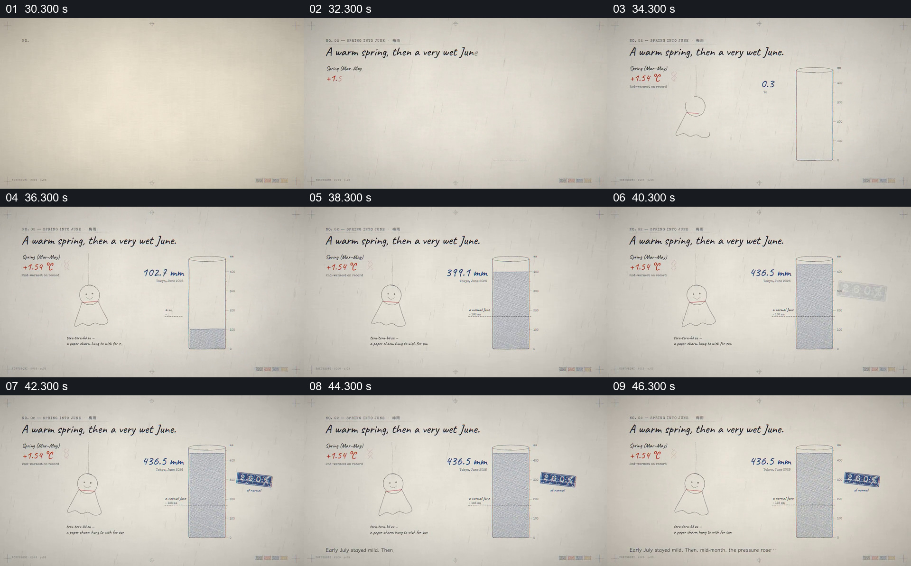

# 用量筒增长展示降雨，并保留气温背景

- 作品：案例 052《日本酷暑的数据图解》（索引名称）。
- 原片范围：00:30.000–00:48.000，含起点、不含终点；[完整原片](../video.mp4)｜[本卡片段](c02.mp4)。
- 观察方式：依据整片 64 宫格和约每秒一次的真实源帧观察，未连续原速观看或听审；声音、语气与完整播放节奏未确认。

## 原画面具体怎样设计

标题写暖春及多雨的六月，左侧显示气温数字和简笔角色；右侧量筒出现，蓝色液面逐步上升，旁边毫米数增长并停在 436.5，旁边还有蓝色标记。

## 为什么这样设计，好在哪里

气温与降雨被放在同一画面，量筒将累计量变成可见高度。数字单位可见，但地点、统计期和数据来源未核查。

以上为依据画面的分析，非作者自述；预期观看效果未经观众测试。

## 可直接使用的创意指令

呈现累计降雨时，先核对地点、时间范围、单位及数据来源，在带刻度的容器或柱形中逐步显示累计量；其他气温数据作为独立背景标注，避免将同时出现写成因果。
