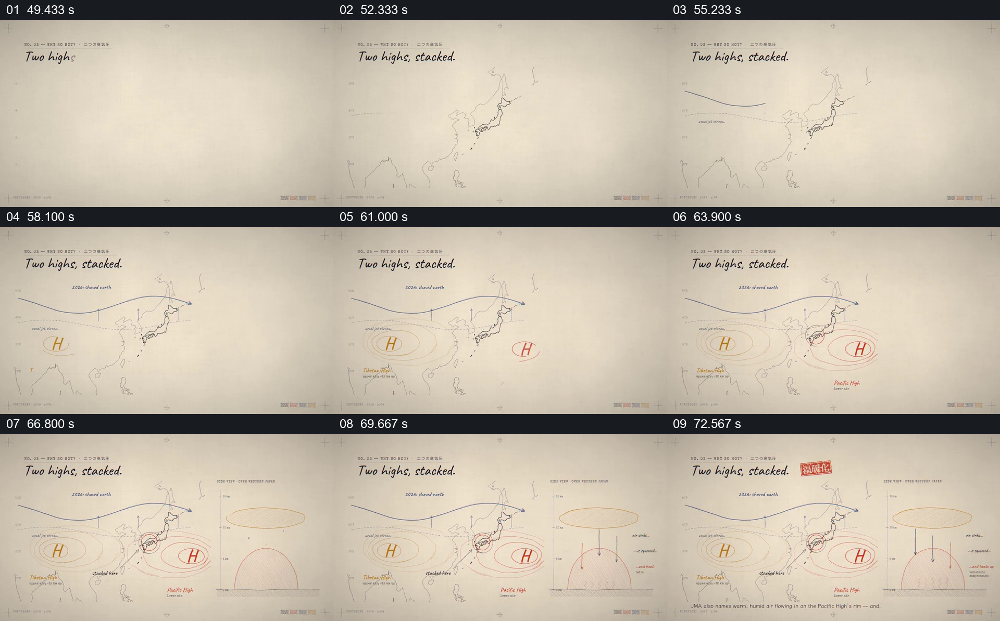

# 在同一地图上建立两层系统，再用侧视图解释叠加

- 作品：案例 052，夏季气象数据可视化（库内案例）。
- 原片范围：49.000–75.000 秒；[完整原片](../video.mp4)｜[本卡片段](c03.mp4)。含起点、不含终点。
- 观察方式：核看全片 64 格和本卡九宫格；未独立连续原速观看或听审，精确运动、节奏、声音及声画关系未知。片中数据未独立核验，迁移尚未实测。

## 原画面具体怎样设计

标题“Two highs, stacked.”下，日本及周边地图线稿先出现；虚线与蓝色曲线分别呈现片中所标常见路径与 2026 年偏北位置。随后左侧黄色高压区和右侧红色高压区分别落在地图两边，日本附近用圈线强调交叠区域。

地图保留在左侧，右边接出一个标注高度的侧视图：上方黄色椭圆、下方红色半圆及向下箭头共同表示垂直关系；文字注释贴近相应对象。最终地图与截面并置，底部短句继续补充片中所述气流条件。

## 为什么这样设计，好在哪里

地图让观众先知道系统相对于日本在哪里，侧视图再回答上下如何叠加；两种视角并列避免把高度关系误读成单纯的平面重叠。颜色和箭头在地图与截面之间保持对应，圈出的地点则充当从整体范围转到局部机制的桥梁。

这是依据示意图的作品分析，不独立证明片中天气系统因果；实际气象关系和标签需要原始资料支持。
