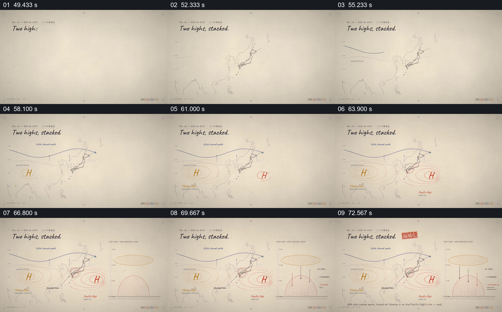

# 在地图上建立两个高压，再用剖面解释叠置

- 作品：案例 052《日本酷暑的数据图解》（索引名称）。
- 原片范围：00:49.000–01:15.000，含起点、不含终点；[完整原片](../video.mp4)｜[本卡片段](c03.mp4)。
- 观察方式：依据整片 64 宫格和约每秒一次的真实源帧观察，未连续原速观看或听审；声音、语气与完整播放节奏未确认。

## 原画面具体怎样设计

纸面线条画出日本与周边区域，一条弯曲线跨过地图；两个标有 H 的区域分别出现并以椭圆线圈表示。右侧剖面中上下两层形状及向下箭头逐步形成，文字说明空气状态。

## 为什么这样设计，好在哪里

地图交代水平位置，剖面补充高度关系，两者并列有助于理解“叠置”所指。片中气象判断和实际因果需要专业来源核验。

以上为依据画面的分析，非作者自述；预期观看效果未经观众测试。

## 可直接使用的创意指令

解释三维天气关系时，依据气象资料先标注地理位置和时间，再用相邻剖面说明高度、气流方向及系统之间的关系；注明示意尺度，因果结论由可靠分析支持。
