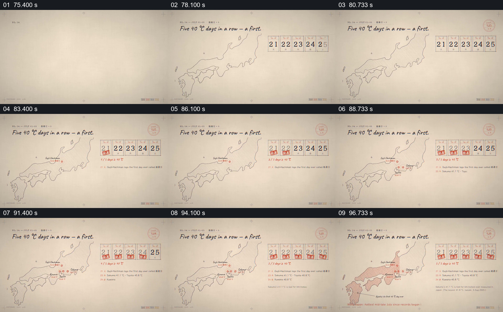

# 把连续日期与地图地点逐日配对

- 作品：案例 052《日本酷暑的数据图解》（索引名称）。
- 原片范围：01:15.000–01:39.000，含起点、不含终点；[完整原片](../video.mp4)｜[本卡片段](c04.mp4)。
- 观察方式：依据整片 64 宫格和约每秒一次的真实源帧观察，未连续原速观看或听审；声音、语气与完整播放节奏未确认。

## 原画面具体怎样设计

日本轮廓图右上排列 21 至 25 的五个日期格；日期逐个盖上红色标记，地图上相应地点出现圆点和名称，下方逐行增加文字。最后部分区域被淡红色填充。

## 为什么这样设计，好在哪里

日期与地点同时保留，使连续性和空间分布可以一起查看；每次只增加一项，有利于追踪事件归属。片中极端温度记录未经核实。

以上为依据画面的分析，非作者自述；预期观看效果未经观众测试。

## 可直接使用的创意指令

当展示连续日期的地理事件时，使用真实日期和地点记录，将日期格与地图标记逐项对应并保留前项；注明测站、阈值与数据来源，填色只表示有依据的范围。
