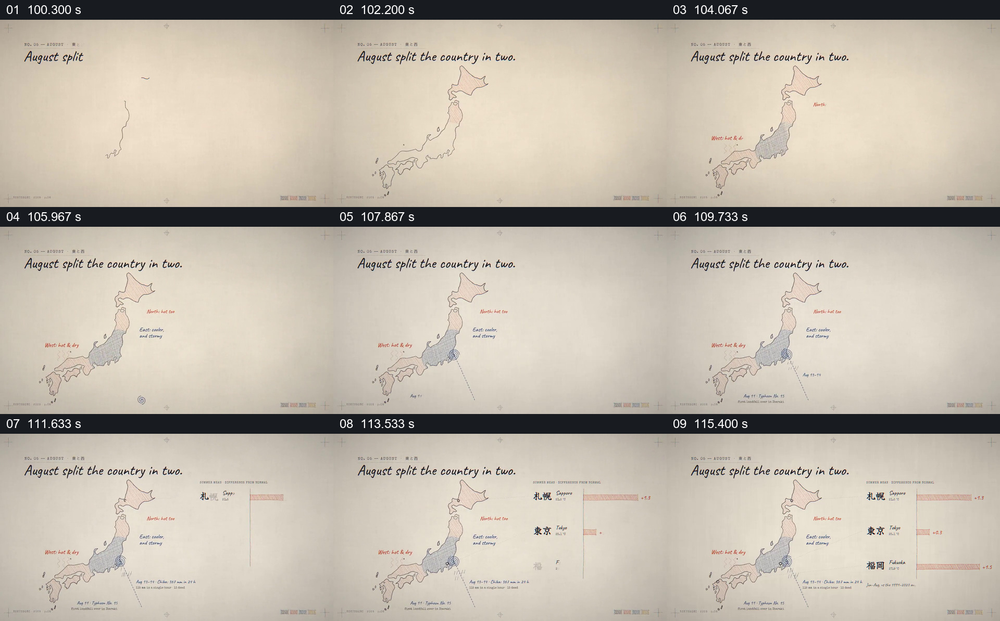

# 用一张地图和城市条形比较地区差异

- 作品：案例 052《日本酷暑的数据图解》（索引名称）。
- 原片范围：01:40.000–01:57.000，含起点、不含终点；[完整原片](../video.mp4)｜[本卡片段](c05.mp4)。
- 观察方式：依据整片 64 宫格和约每秒一次的真实源帧观察，未连续原速观看或听审；声音、语气与完整播放节奏未确认。

## 原画面具体怎样设计

日本地图逐渐分为不同颜色区域，旁边标注各区域的情况；右侧依次出现札幌、东京、福冈三行横向条形及数值。

## 为什么这样设计，好在哪里

地图先定位空间差异，再以城市条形提供可比较的量化例子。颜色与数值的口径和片中结论未独立核查。

以上为依据画面的分析，非作者自述；预期观看效果未经观众测试。

## 可直接使用的创意指令

比较区域差异时，先按同一时间与指标标注真实地区，再选取有代表性的地点用共同尺度画条形；提供来源和单位，并解释地点例子与整片区域的关系。
