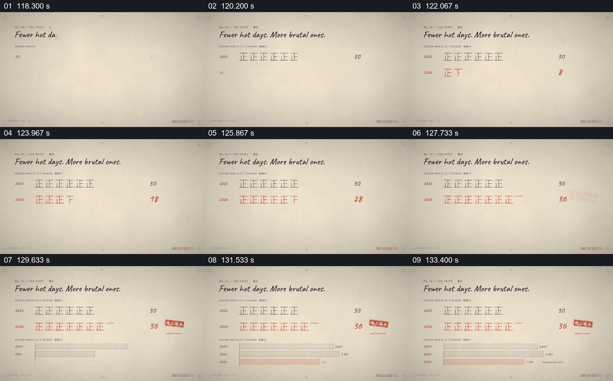

# 先累计极端事件，再用另一组横条补上总体数量

- 作品：案例 052，夏季气象数据可视化（库内案例）。
- 原片范围：118.000–135.000 秒；[完整原片](../video.mp4)｜[本卡片段](c06.mp4)。含起点、不含终点。
- 观察方式：核看全片 64 格和本卡九宫格；未独立连续原速观看或听审，精确运动、节奏、声音及声画关系未知。片中数据未独立核验，迁移尚未实测。

## 原画面具体怎样设计

纸面标题写“Fewer hot days. More brutal ones.”，上半部先列出 2025 年的正字记数及数字 30，再用红色逐步建立 2026 年的一行，右侧数字变化至 36，并出现红色“最多”印记；两行保持同一横向位置。

随后下半部出现另一组 35°C 以上站日的横条，按 2024、2025、2026 三行排列，2026 用红色，其余为灰色；各条末端出现数字。上面的极端阈值计数与下面的较宽阈值数量同时留在一页，标题解释片中想呈现的差异。

## 为什么这样设计，好在哪里

上半部分用正字和数字表现“发生次数的累积”，下半部分改用横条便于比较不同年份的较大总量；同一页中明确写出两个温度阈值，可以让看似矛盾的两个结论并存。红色把本次重点年份贯穿两个图，却没有抹去其他年份作为参照。

阈值、站日、年份及结果是原片数据，尚未独立核实。正字变化发生于抽样之间，精确速度和声音配合未知。
