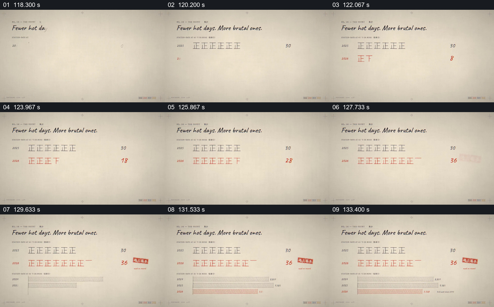

# 用计数笔画和条形图比较两年的不同指标

- 作品：案例 052《日本酷暑的数据图解》（索引名称）。
- 原片范围：01:58.000–02:15.000，含起点、不含终点；[完整原片](../video.mp4)｜[本卡片段](c06.mp4)。
- 观察方式：依据整片 64 宫格和约每秒一次的真实源帧观察，未连续原速观看或听审；声音、语气与完整播放节奏未确认。

## 原画面具体怎样设计

纸色背景显示 2025、2026 两行计数笔画和数字，后者逐渐增至 36，前者停在 30；下方再出现按年度排列的横向条形。

## 为什么这样设计，好在哪里

逐笔计数让年度差值逐渐显现，另设条形承载另一指标，避免两个不同口径混为一项。数字及两组数据的具体统计口径未核实。

以上为依据画面的分析，非作者自述；预期观看效果未经观众测试。

## 可直接使用的创意指令

比较年度数据时，明确每组的指标、时间和单位；用一致规则累积计数，再另设尺度展示不同指标，给出原始数据来源。不得仅凭画面声称异常原因。
