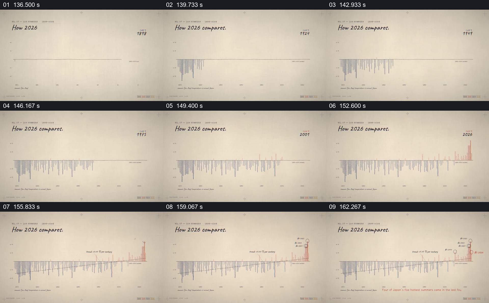

# 让多年柱形序列逐步延伸到当前年份

- 作品：案例 052《日本酷暑的数据图解》（索引名称）。
- 原片范围：02:16.000–02:45.000，含起点、不含终点；[完整原片](../video.mp4)｜[本卡片段](c07.mp4)。
- 观察方式：依据整片 64 宫格和约每秒一次的真实源帧观察，未连续原速观看或听审；声音、语气与完整播放节奏未确认。

## 原画面具体怎样设计

标题写“How 2026 compares.”，一条水平基线下方逐渐出现按年份排列的蓝色柱；后期红色柱逐步增多，年份推进到 2026，斜向趋势线和若干圈注加入。

## 为什么这样设计，好在哪里

先形成完整历史参照，再标注近期位置，观众能看到重点年份处于哪段分布。轴、基准和数据精度需要查原资料；趋势不单独证明原因。

以上为依据画面的分析，非作者自述；预期观看效果未经观众测试。

## 可直接使用的创意指令

当比较某一年与长期历史时，先取得同口径序列并明确基准和缺测情况，按时间建立完整图表，再标出目标年份及有依据的趋势；保留单位与来源，避免用装饰增长代替数据。
