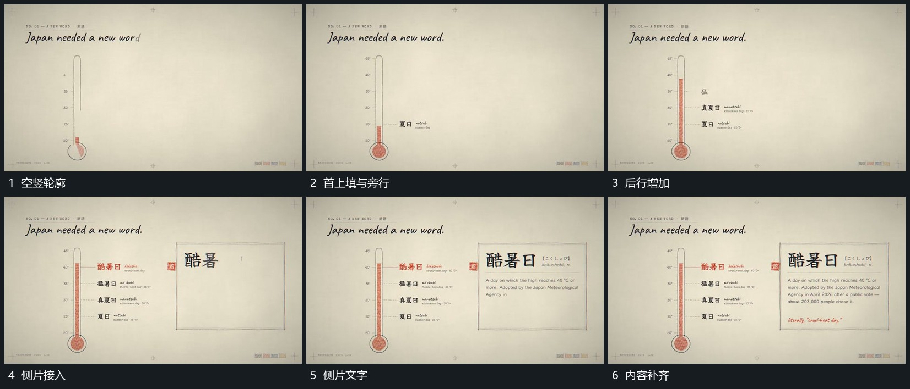

# 竖向刻度先立轮廓，沿轴上填后追加旁行与侧片

## 运动指令

先建立竖向刻度轮廓，从下沿轴向上填入内部区域。达到不同位置时在旁侧追加短行，前行保持；随后在侧方接入独立片面，逐项补齐其内部内容。

## 视频切片

[播放本机制的原片切片](m01.mp4)

覆盖分镜中“空竖轮廓”至“内容补齐”的连续过程，并保留邻近的前后衔接画面；原片中交叠发生的动作一并保留。

## 分镜过程

## 组合与调整

高度与标签由新材料决定，保留轴向位置和旁行对应关系。
