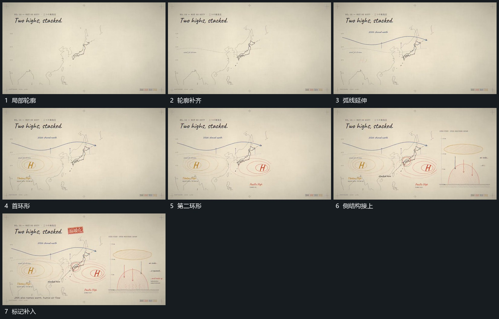

# 大轮廓逐段描出，弧线与局部环形错峰接续

## 运动指令

从少量线段开始补齐大轮廓，再在其上延伸弧向线。局部环形错峰加入，已有线保持；侧边结构及向下箭头最后接上，使平面关联转到侧结构的接续清楚。

## 视频切片

[播放本机制的原片切片](m03.mp4)

覆盖分镜中“局部轮廓”至“标记补入”的连续过程，并保留邻近的前后衔接画面；原片中交叠发生的动作一并保留。

## 分镜过程

## 组合与调整

轮廓不必是原题材，重点是先完整承载再建立关联。
