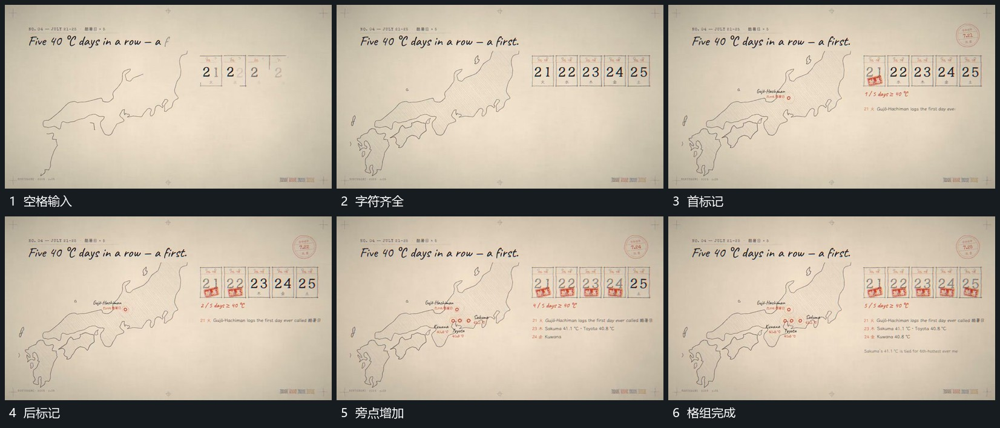

# 一排空格逐项填字符，再依次补标记，旁点同步增加

## 运动指令

让空格沿横向依次填入字符，前格完成后保持。字符齐全后逐格追加短标记，旁侧轮廓上对应的小点和下部短行随推进增加，形成共同的先后关系。

## 视频切片

[播放本机制的原片切片](m04.mp4)

覆盖分镜中“空格输入”至“格组完成”的连续过程，并保留邻近的前后衔接画面；原片中交叠发生的动作一并保留。

## 分镜过程

## 组合与调整

数量可调，不按原片日期或地点命名动作。
