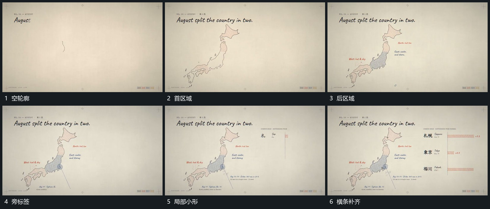

# 轮廓内部区域分块填入，旁标签与横条接续

## 运动指令

保留大轮廓，在内部按区域分别填入，前区域保持，后区域接续。各区建立后在旁侧追加标签，再从侧边延长横条和局部小形，整体稳定。

## 视频切片

[播放本机制的原片切片](m05.mp4)

覆盖分镜中“空轮廓”至“横条补齐”的连续过程，并保留邻近的前后衔接画面；原片中交叠发生的动作一并保留。

## 分镜过程

## 组合与调整

不分析区域代表什么。填充范围由本片表达决定。
