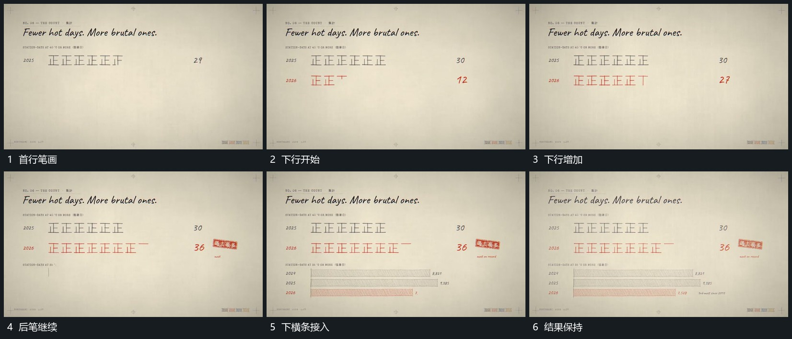

# 短笔画累计成行，数值增长，下一行与附属横条随后建立

## 运动指令

在固定行位逐笔增加短线，笔画累积成组，旁数值随之增长。首行稳定后建立下一行，后一行继续累积，最后在下方补横条作为附属结果。

## 视频切片

[播放本机制的原片切片](m06.mp4)

覆盖分镜中“首行笔画”至“结果保持”的连续过程，并保留邻近的前后衔接画面；原片中交叠发生的动作一并保留。

## 分镜过程

## 组合与调整

笔画形态可简化，但必须保留逐笔建立过程，不能完整字符一次显示。
