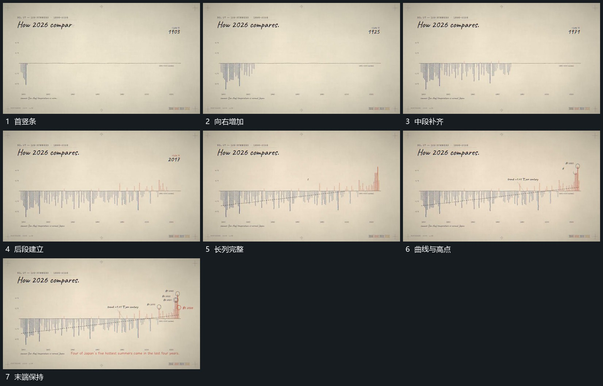

# 沿共同基线逐项补竖条，末端曲线与高点标记后到

## 运动指令

沿共同基线从左向右补入竖条，各条从基线向不同方向延长，已出现条保持。完整序列建立后增加经过条组的曲线，再为末端高点补圈形与短标记，收住视线。

## 视频切片

[播放本机制的原片切片](m07.mp4)

覆盖分镜中“首竖条”至“末端保持”的连续过程，并保留邻近的前后衔接画面；原片中交叠发生的动作一并保留。

## 分镜过程

## 组合与调整

条数可缩减，保持共同基线和增长方向，不继承原数据含义。
