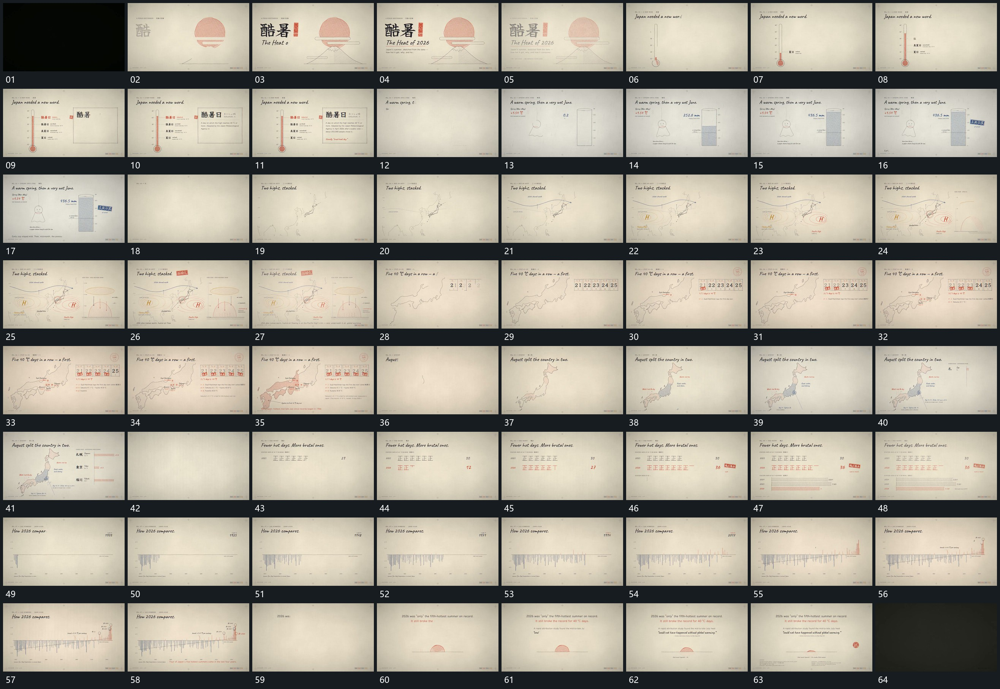

# 052｜原片运动总览

[观看完整原片](video.mp4)

## 运动总览

开头轮廓、主字与附属行逐项建立后退弱。竖向刻度先立轮廓，沿轴上填后追加旁行与侧片 先立竖向刻度轮廓，再沿轴上填，旁侧短行逐项追加，右片接入并补齐内容。立形内由下上填，数值增长后局部短标记接入 在另一空立形内由下向上填充，数值增加，局部标记稍后到位。

中段 大轮廓逐段描出，弧线与局部环形错峰接续 从少量线段描出大轮廓，再延伸弧向线，环形局部与侧边箭头结构接续。一排空格逐项填字符，再依次补标记，旁点同步增加 让一排空格逐项填入字符，再按顺序添加短标记，旁轮廓上的点与下部短行同步增加。轮廓内部区域分块填入，旁标签与横条接续 将轮廓内部区域分块填入，旁侧标签和横条随后补齐。

后段 短笔画累计成行，数值增长，下一行与附属横条随后建立 以短笔画累计成行，数值增长，完成一行后再建下行，附属横条延长。沿共同基线逐项补竖条，末端曲线与高点标记后到 沿共同基线从左向右补入竖条，末端曲线与高点标记随后建立。最后旧组退去，中央字组分行补齐，底部半圆缩小并退去，附属说明保持结束。

## 完整运动段落

以下按原片中的出现顺序引用。建立、内部发展及完成反馈放在同一段中；同时发生的局部动作与运镜写在同一份指令里。不同段之间可以是连续接管，也可以是直接切换，不能仅凭条目相邻认定可直接拼接。重复出现的同类运动采用一次连续代表范围，切片不以逐段无缝覆盖整片为目标。

1. [竖向刻度先立轮廓，沿轴上填后追加旁行与侧片](mechanisms/m01.md)：轮廓先在，填充和旁项接续

2. [立形内由下上填，数值增长后局部短标记接入](mechanisms/m02.md)：填充增长，数值接续，标记后到

3. [大轮廓逐段描出，弧线与局部环形错峰接续](mechanisms/m03.md)：轮廓先建立，关系线再补

4. [一排空格逐项填字符，再依次补标记，旁点同步增加](mechanisms/m04.md)：字符先在，标记随后增加

5. [轮廓内部区域分块填入，旁标签与横条接续](mechanisms/m05.md)：填区先发生，标签后到

6. [短笔画累计成行，数值增长，下一行与附属横条随后建立](mechanisms/m06.md)：先首行，后下行，结果再补

7. [沿共同基线逐项补竖条，末端曲线与高点标记后到](mechanisms/m07.md)：竖条从左向右增加，曲线后补

切片保留起始准备、必要内部停顿和完成或明确交接；首尾省略无新发展的等待，持续运动不要求人为停住。以上基于真实源帧序列和重点边界核对，不等同于全片连续声画审片。

## 完整64宫格

