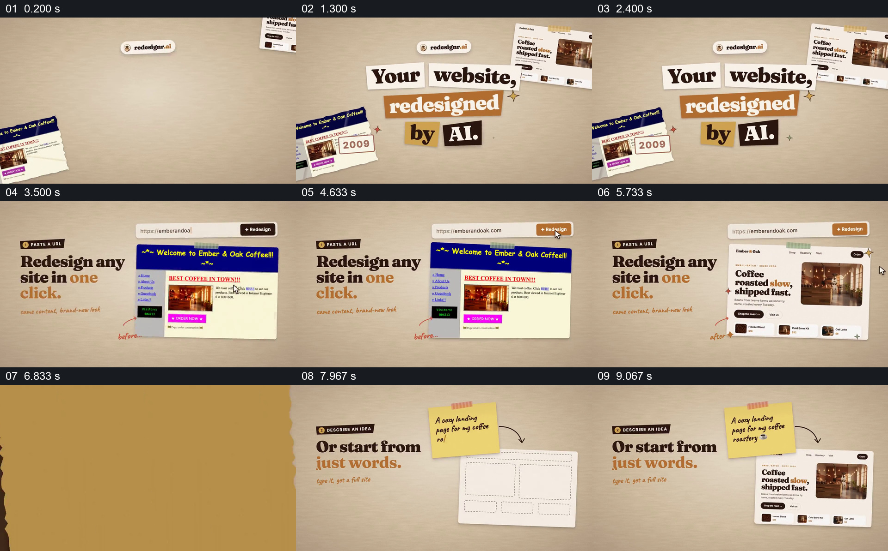

# 让旧页面和一句需求分别通向同一新版网站

- 作品：案例 029《网页截图与剪贴排版》（库内索引名称）。
- 原片范围：00:00.000–00:10.000，含起点、不含终点；[完整原片](../video.mp4)｜[本卡片段](c01.mp4)。
- 范围依据：从剪贴式标题和新旧页面建立，到网址改版及文字描述两条路径均显示新版结果；10 秒后转入不同风格。
- 观察方式与未确认范围：查看整片 64 帧总览和本卡分镜。未独立完成连续原速观看与听审；抽帧之间的运动、停顿与声音配合待复核。画面中的界面、数字与说明是作品呈现，未经额外核实；设计价值为基于画面的分析。

## 原画面具体怎样设计

米色纸面上，咖啡网站的旧页面和新版截图分别位于两侧，中央标题由白、橙、黄、黑色纸块组成，提出网站重新设计。接下来左侧固定大标题，右侧地址栏下贴着蓝黄色旧站，旁边手写 before；之后同一位置显示照片、标题和按钮重新排版的新版，标为 after。

画面改为第二种入口：左侧写“从文字开始”，右上黄色便签写咖啡烘焙网站需求，箭头指向下方空白线框页面；后续抽帧中同一位置出现此前的新版咖啡网站。纸面、左侧说明和右侧结果维持相似布局，便签取代网址成为新的起点。

## 为什么这样设计，好在哪里

新版与旧版被放到同一位置，观众更容易比较同一咖啡内容的视觉变化；第二次保留新版结果而替换输入，使两种路径的区别集中在网址与描述，不必重新解释目标。纸条、胶带和手写箭头则把网页截图与说明放在一个可读的剪贴空间。

此处是视觉演示，不足以证明同一网站确由这两种输入实际生成。

## 可直接使用的创意指令

先选一个有可核对旧版与新版的具体对象，在同一版位呈现改造前后，保留能确认其身份的名称或内容。若要比较另一种起点，把输入材料换成真实简述、草图或其他凭据，用箭头或版位关系指向同一结果；让观众看得出两条路径的共同终点。

纸质美术、颜色和页面形式可以重做；输入、结果及其关联需要准确标注，不能用演示画面冒充实际操作。

本方法尚未在新题材中实测。
