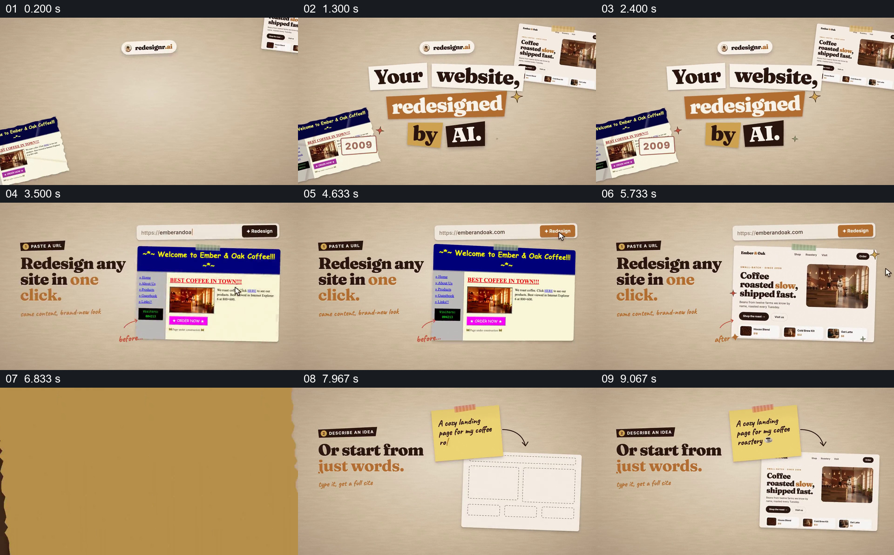

# 让旧页面和一句需求分别通向同一新版网站

- 作品：案例 029《网页截图与剪贴排版》（库内索引名称）。
- 原片范围：00:00.000–00:10.000，含起点、不含终点；[完整原片](../video.mp4)｜[本卡片段](c01.mp4)。
- 范围依据：从剪贴式标题和新旧页面建立，到网址改版及文字描述两条路径均显示新版结果；10 秒后转入不同风格。
- 观察方式与未确认范围：查看整片 64 帧总览和本卡分镜。未独立完成连续原速观看与听审；抽帧之间的运动、停顿与声音配合待复核。画面中的界面、数字与说明是作品呈现，未经额外核实；设计价值为基于画面的分析。

## 原画面具体怎样设计

米色纸面上，咖啡网站的旧页面和新版截图分别位于两侧，中央标题由白、橙、黄、黑色纸块组成，提出网站重新设计。接下来左侧固定大标题，右侧地址栏下贴着蓝黄色旧站，旁边手写 before；之后同一位置显示照片、标题和按钮重新排版的新版，标为 after。

画面改为第二种入口：左侧写“从文字开始”，右上黄色便签写咖啡烘焙网站需求，箭头指向下方空白线框页面；后续抽帧中同一位置出现此前的新版咖啡网站。纸面、左侧说明和右侧结果维持相似布局，便签取代网址成为新的起点。

## 为什么这样设计，好在哪里

新版与旧版被放到同一位置，观众更容易比较同一咖啡内容的视觉变化；第二次保留新版结果而替换输入，使两种路径的区别集中在网址与描述，不必重新解释目标。纸条、胶带和手写箭头则把网页截图与说明放在一个可读的剪贴空间。

此处是视觉演示，不足以证明同一网站确由这两种输入实际生成。

## 完整照排指令

以[完整原片](../video.mp4)的 0–10 秒为准。画幅 1280×720，源帧率 30/1。以下拍点为抽帧定位，位置按画幅百分比取近似值。

### 用料

【旧站截图】【新版截图】【需求便签】【新版线框】须指向同一站点和同一内容，前后保留站名、关键商品或主图等可辨锚点。备【剪贴标题】【地址文字】【改版主句】【需求主句】【按钮短字】。真实改版附可打开的旧站存档、新版及输入记录。界面以可展示的截图或自有设计为准。

### 按源时刻摆放

1. **0.000–约 3.000 秒。** 哑暖卡纸底。中央以黑粗衬线【剪贴标题】拆成数个纸条，逐层压成两三行，强调字置赭色纸上。左右边缘各斜放小幅新旧页预览，右上接暖白版，左侧或左下留较亮旧版。图块在标题成形时仍可辨，静态允许轻移。
2. **约 3.000–6.700 秒。** 同底改左右双栏。左边薄暗小签与黑粗【改版主句】左齐，末词用赭色。右上以白长条【地址文字】和窄赭【按钮短字】建立输入，下面先放饱和色【旧站截图】，再同位替换为较整洁的【新版截图】。网页单窗从旧到新位置不变，两图共用相同内容锚点，不靠不相干页面强化差异。
3. **约 6.700–10.000 秒。** 左栏换【需求主句】，保留原有粗细和色重。右上以小号淡黄【需求便签】斜贴，深色手写短句从少到多；细弧箭头连到其右下【新版线框】或【新版截图】。新版延续前一途径的画面结果。便笺、指向线和结果留到边界，皆可静态分层，显现顺序只走一次。按 10.000 秒切出。

### 局部采用

已有旧站与新版可采用约 3.000–6.700 秒；只有可核对的需求及配对设计可采用约 6.700–10.000 秒。

### 验证状态

已对照逐秒原片画序并读回，核对纸字与网页小图、地址栏下同位换新版、黄色便签及指向关系。线框详细状态、精确切帧与换料试摆待核。
