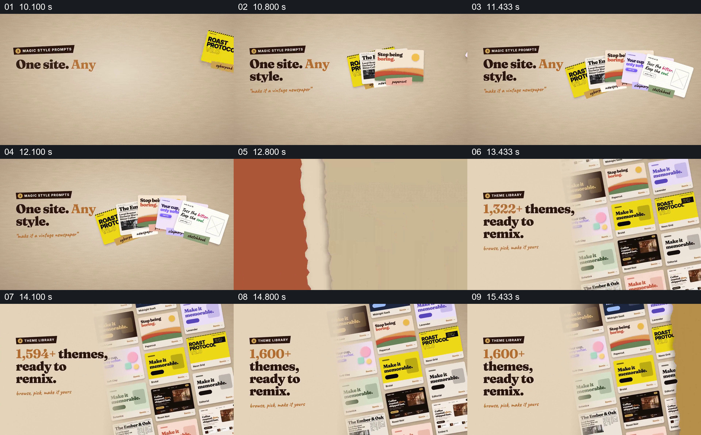

# 用同主题页面组展示风格变化与样例规模

- 作品：案例 029《网页重设计与编辑演示》（索引名称）。
- 原片范围：00:10.000–00:16.000，含起点、不含终点；[完整原片](../video.mp4)｜[本卡片段](c02.mp4)。
- 观察方式：依据整片 64 宫格和约每秒一次的真实源帧观察，未连续原速观看或听审；声音、语气与完整播放节奏未确认。

## 原画面具体怎样设计

左侧写“One site. Any style.”，右侧几张不同颜色和排版的网页卡扇形排列；随后右侧形成密集网页样例墙，左侧数字增长并显示“1,600+ themes, ready to remix.”。

## 为什么这样设计，好在哪里

先并列少量不同版本让风格差异可辨，再扩展为样例墙传达选择范围。数量是片中宣传，未核实统计口径或实际模板。

以上为依据画面的分析，非作者自述；预期观看效果未经观众测试。

## 可直接使用的创意指令

当同一内容有多种可选视觉方向时，用相同主体或相同信息结构制作少量可辨的样例并列，随后展示实际可用的样例集合。样例数量应依据当前库统计，避免用密集拼贴代替可查找的真实内容。
