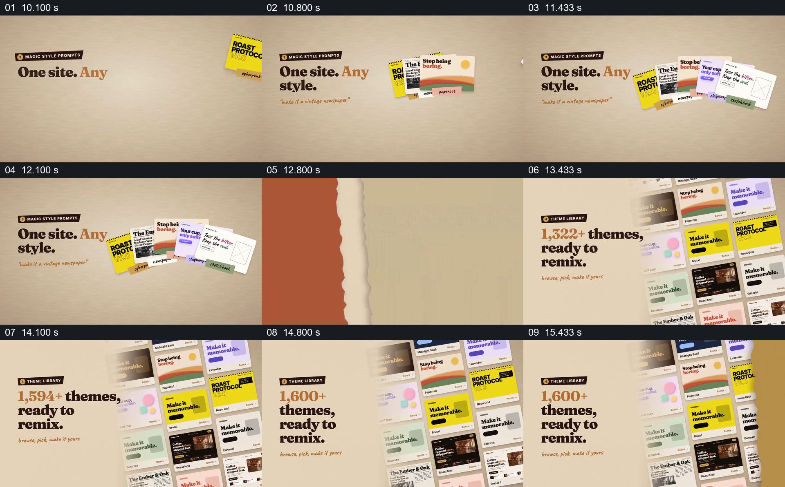

# 先并列少量风格示例，再把相似卡片扩展成模板墙

- 作品：案例 029《网页截图与剪贴排版》（库内索引名称）。
- 原片范围：00:10.000–00:16.000，含起点、不含终点；[完整原片](../video.mp4)｜[本卡片段](c02.mp4)。
- 范围依据：从风格命题与第一张样片开始，保留样片集合和模板库数量结果；16 秒进入页面搭建。
- 观察方式与未确认范围：查看整片 64 帧总览和本卡分镜。未独立完成连续原速观看与听审；抽帧之间的运动、停顿与声音配合待复核。画面中的界面、数字与说明是作品呈现，未经额外核实；设计价值为基于画面的分析。

## 原画面具体怎样设计

米色纸面左侧是“One site. Any style.”及手写风格提示，右侧先出现一张黄色页面，随后不同色彩和排版的页面卡片层叠展开，底部各有风格标签。它们共享同一观看位置，却在颜色、字体与版式上明显不同。

一条撕纸边界后，右侧变为倾斜排列的多列模板卡片墙，左侧大字显示模板数量，抽帧中数字由较小值变为 1,600+。部分小样沿用前面看到的风格，示例组扩展成可浏览的集合。

## 为什么这样设计，好在哪里

先用少量足够大的卡片让人看清“不同”体现在哪里，再通过多列缩略图表现选择范围；如果只展示数量，缺少直观差异，如果只展示少数样片，也无法说明更大的集合。保持左侧命题、右侧实例的阅读关系，使样片与模板库的转变容易理解。

数字为片中声称，未经本次核实；抽帧不足以判断数字变化的速度与节奏。

## 完整照排指令

以[完整原片](../video.mp4)的 10–16 秒为准。画幅 1280×720，源帧率 30/1。以下拍点为抽帧定位，位置按画幅百分比取近似值。

### 用料

【风格样卡组】备同题材的多套真实结果，文字用途相近，视觉风格不同。【模板墙组】应收录前面能认出的样卡，再补同一目录的页面。备【风格标题】【模板总数】【模板单位】【模板附注】【邻段标题】【邻段编辑页】。数量用同一目录的可打开来源及日期，滚动中间值仅承担动画。

### 按源时刻摆放

1. **10.000–约 12.500 秒。** 暖米纸纹满底。左侧 x6% 左齐短黑眉签及黑粗衬线【风格标题】，强调词赭橙。右侧先摆一块明黄【风格样卡组】样卡，再由旁边追加数块不同颜色的页面，轻错角、彼此叠边，亮卡仍露一截。每项风格各自可辨，最晚到位的页也只占相近尺度。静态页可做旋转和分层入场。
2. **约 12.500–约 15.300 秒。** 赭色纸面短扫过，右侧旧叠组转成倾斜多列【模板墙组】，窄浅缝，画顶和右缘可截。左侧保留大片空白，用赭色大【模板总数】从低值滚到终值，与黑粗【模板单位】合成两三行，下面小灰【模板附注】。墙上各页从入场到退场留在原槽，可用定格或整墙缓移，禁止快换到无关目录。
3. **约 15.300–16.000 秒。** 墙向边缘退出，新暖纸版上以左侧【邻段标题】和右侧近白【邻段编辑页】接入。按 16.000 秒截出；单用模板范围时在编辑页出现前结束。

### 局部采用

只有对应的三四套风格可用 10–约 12.500 秒。只有可核查目录时可用约 12.500–15.300 秒，并明确哪些是缩图示例。

### 验证状态

已对照每秒两帧原片画序并读回，核对样卡累积、赭面过门、斜墙与左边大数、编辑页切出。准确切帧、计数细节与换料待核。
