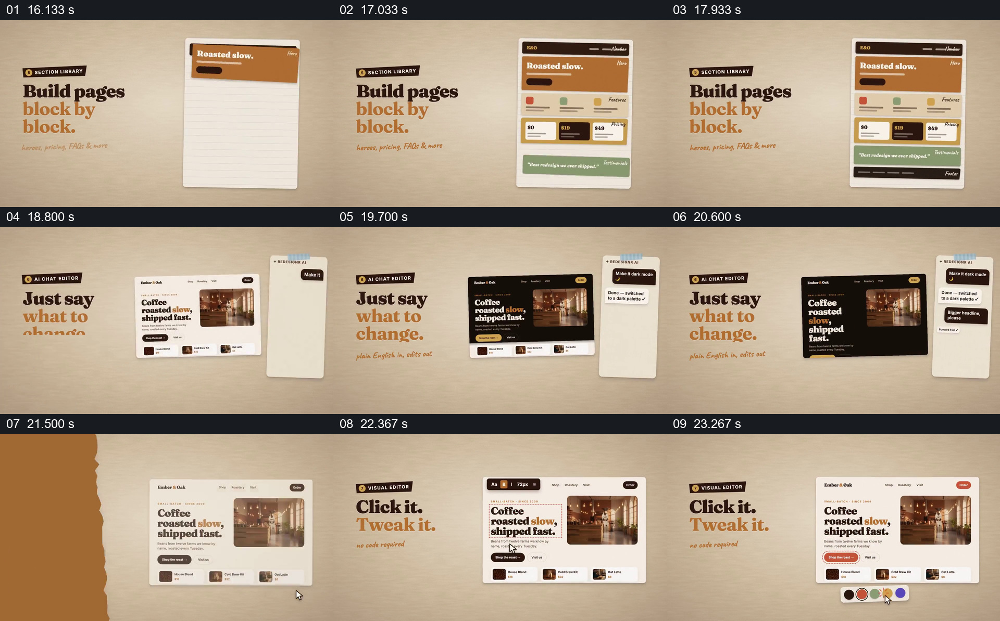

# 从页面模块堆叠到对同一网站的对话与局部修改

- 作品：案例 029《网页截图与剪贴排版》（库内索引名称）。
- 原片范围：00:16.000–00:24.000，含起点、不含终点；[完整原片](../video.mp4)｜[本卡片段](c03.mp4)。
- 范围依据：从空白页面和模块建立，经过对话修改与局部颜色选择，到页面修改结果显露；之后进入代码交付段。
- 观察方式与未确认范围：查看整片 64 帧总览和本卡分镜。未独立完成连续原速观看与听审；抽帧之间的运动、停顿与声音配合待复核。画面中的界面、数字与说明是作品呈现，未经额外核实；设计价值为基于画面的分析。

## 原画面具体怎样设计

左侧大字说明逐块搭建，右侧一张带横线的纸页先出现标题区，再加入功能、价格、评价和页脚等不同色块，形成完整页面。随后切到前面出现过的咖啡网站：左边仍是功能说明，右边多出一条竖向对话纸条；文字提出深色模式，网站抽帧从浅色变成深色，后续又显示放大标题的请求。

撕纸样的画面切换后，相同咖啡页面回到浅色，标题区域带选中边框和文字工具条；下一状态按钮被圈选，下方出现一排色块，按钮颜色发生变化。页面内容和咖啡照片保持可识别，变化集中在被说明或选中的位置。

## 为什么这样设计，好在哪里

示意模块先解释页面结构，真实感更强的页面再承担具体修改；对话纸条与页面并置，把请求和结果放在同一视线范围。最后的选框和色板让观众知道变化发生在哪个对象上，同一咖啡网站贯穿不同修改方式，避免每次换界面导致重新识别。

截帧只能确认前后状态，不证明操作实时生效，也不能确认光标动作和变化的精确同步。

## 可直接使用的创意指令

用同一页面内容先展示少数有明确作用的模块如何形成完整结构，再选择一到两个可核对的修改：把自然语言请求放在页面旁，展示对应的实际结果；局部调整时保留选区和控件，让人看到具体改了哪里。

模块的种类、沟通方式和页面风格均可调整；保持页面身份一致并展示修改前后，若只是动画模拟应明确标明。

本方法尚未在新题材中实测。
