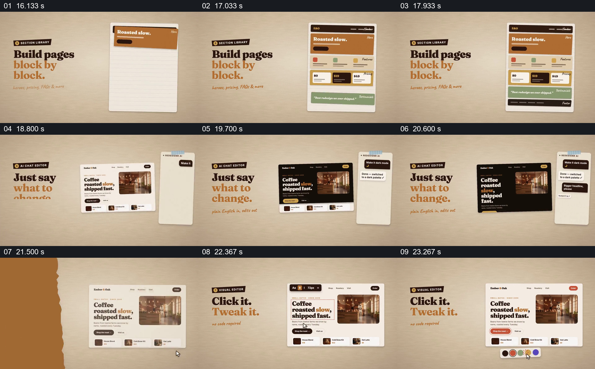

# 从页面模块堆叠到对同一网站的对话与局部修改

- 作品：案例 029《网页截图与剪贴排版》（库内索引名称）。
- 原片范围：00:16.000–00:24.000，含起点、不含终点；[完整原片](../video.mp4)｜[本卡片段](c03.mp4)。
- 范围依据：从空白页面和模块建立，经过对话修改与局部颜色选择，到页面修改结果显露；之后进入代码交付段。
- 观察方式与未确认范围：查看整片 64 帧总览和本卡分镜。未独立完成连续原速观看与听审；抽帧之间的运动、停顿与声音配合待复核。画面中的界面、数字与说明是作品呈现，未经额外核实；设计价值为基于画面的分析。

## 原画面具体怎样设计

左侧大字说明逐块搭建，右侧一张带横线的纸页先出现标题区，再加入功能、价格、评价和页脚等不同色块，形成完整页面。随后切到前面出现过的咖啡网站：左边仍是功能说明，右边多出一条竖向对话纸条；文字提出深色模式，网站抽帧从浅色变成深色，后续又显示放大标题的请求。

撕纸样的画面切换后，相同咖啡页面回到浅色，标题区域带选中边框和文字工具条；下一状态按钮被圈选，下方出现一排色块，按钮颜色发生变化。页面内容和咖啡照片保持可识别，变化集中在被说明或选中的位置。

## 为什么这样设计，好在哪里

示意模块先解释页面结构，真实感更强的页面再承担具体修改；对话纸条与页面并置，把请求和结果放在同一视线范围。最后的选框和色板让观众知道变化发生在哪个对象上，同一咖啡网站贯穿不同修改方式，避免每次换界面导致重新识别。

截帧只能确认前后状态，不证明操作实时生效，也不能确认光标动作和变化的精确同步。

## 完整照排指令

以[完整原片](../video.mp4)的 16–24 秒为准。画幅 1280×720，源帧率 30/1。以下拍点为抽帧定位，位置按画幅百分比取近似值。

### 用料

【网页模块组】按标题区、功能、价格与评价准备同一站点的内容，能够逐段加入，不重复标题。备【站点原版】【对话改版】【点选改版】，保留相同主图、商品名称和浏览器裁切。另备【阶段题组】【对话请求】【对话反馈】【调整选项】【交付邻段】。真实修改留可复查的站点链接、版本及记录。

### 按源时刻摆放

1. **16.000–约 18.800 秒。** 暖米纸底，左边 x6% 依次摆短暗眉签、两至三行【阶段题组】，深棕粗衬线，强调行用赭。右半白竖【网页模块组】的浏览器框沿中上建立，保留小顶栏。首模块以暖棕宽块先填，随后在其下累积功能小格、价格和评价，前模块持续。仅模块位置显隐，框体勿抖。
2. **约 18.800–21.000 秒。** 短色面过门，左题保留量级但更新。中右显示横向【站点原版】，最右窄白对话列，暗小泡逐条添【对话请求】【对话反馈】。过程中网页在同位置换到【对话改版】的近黑配色，保留咖啡图、名称及对象关系。白对话持续到整版退出，原请求不能被下一个动作顶去。
3. **约 21.000–23.300 秒。** 暗竖块擦过后，暖底回到左右区，右页切入【点选改版】。靠近点击位置打开独立小控件，下方成排色点【调整选项】，选定时对应局部更新，未选区域保持。可用同源静页分层，单次选色动画不循环。
4. **约 23.300–24.000 秒。** 将旧页退出，右边暗色【交付邻段】入场，左题换下一短句。按 24.000 秒切出。

### 局部采用

只有完整模块时可单用 16–约 18.800 秒；只有可核对的网页前后版及请求时，可用约 18.800–21 秒。点选改色需同一页面及可核对局部状态。

### 验证状态

已对照每秒两帧画序并读回。核对模块保留、对话区与原页同屏、改色控件在当前页下方和交付拍切入。精确切帧、字段原文和换料待核。
