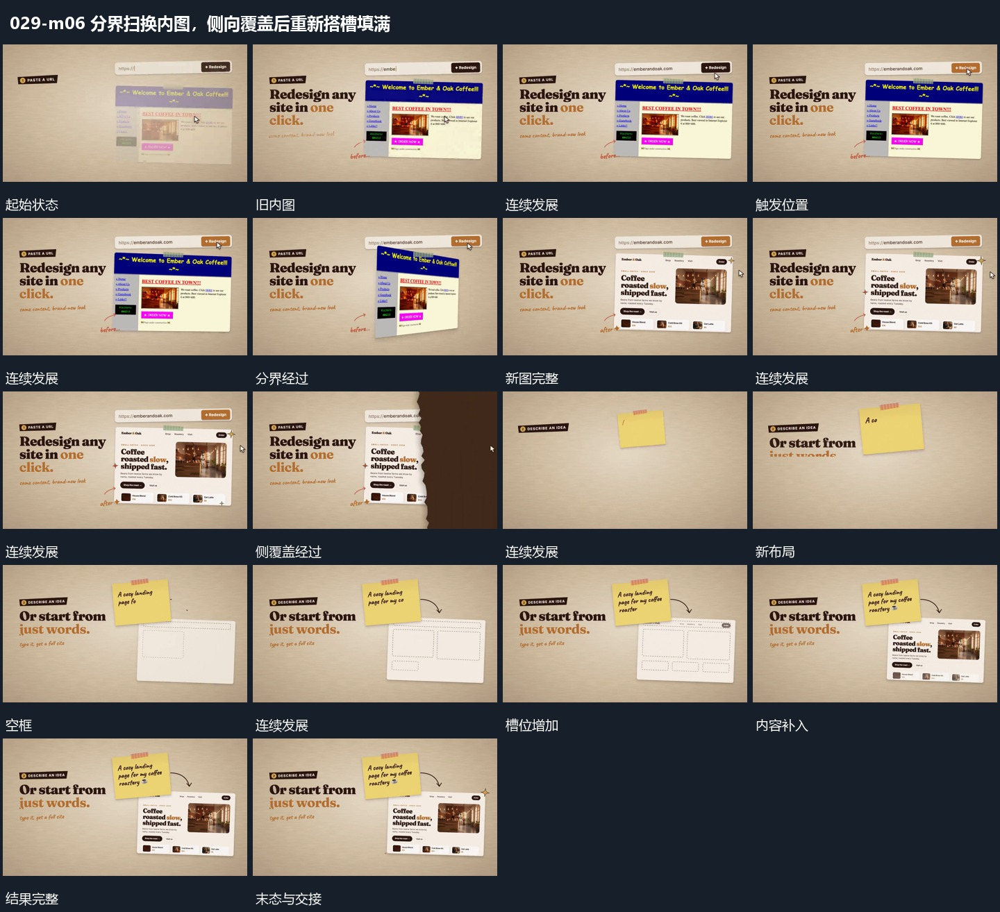

# 分界扫换内图，侧向覆盖后重新搭槽填满

## 运动指令

分界先改变固定图内的内容，再由侧向不齐边缘覆盖交接；新布局先建立空槽，图文随后逐项补齐。

1. **竖向分界换内图，侧方不齐边缘覆盖接替下一组**

让竖向分界横向经过框内，左侧新内容逐步替换右侧旧内容。框内替换完成后，不齐边缘的覆盖从侧方通过，遮住整组并揭出下一布局。

2. **虚线槽逐项建立，内部图文随后补齐**

先在空框内建立虚线槽，从少到多补齐。各槽明确后依次填入图块、短行和小标签，先填好的保留，最后形成完整组。

整段结束：图文完整，虚线范围成为承载区 保留必要落稳与交接，中间已建立的参照沿用到下一步骤。

## 视频切片

[播放本机制的原片切片](m06.mp4)

保留起始准备、连续发展和完成或明确交接；首尾按本段运动范围裁切，不拼接、不变速。相连的小动作合为同一完整段落。

## 分镜过程

## 组合与调整

分界先改变固定图内的内容，再由侧向不齐边缘覆盖交接；新布局先建立空槽，图文随后逐项补齐。 复用时可调整元素数量、幅度和相对节奏，保留上述进入、交叠与完成关系；不直接沿用原片题材或时长。

局部替换与整组转场可分别用，务必区分两种承载范围。

可以减槽位，保留先范围后内容，不能把模板名字当运动说明。
