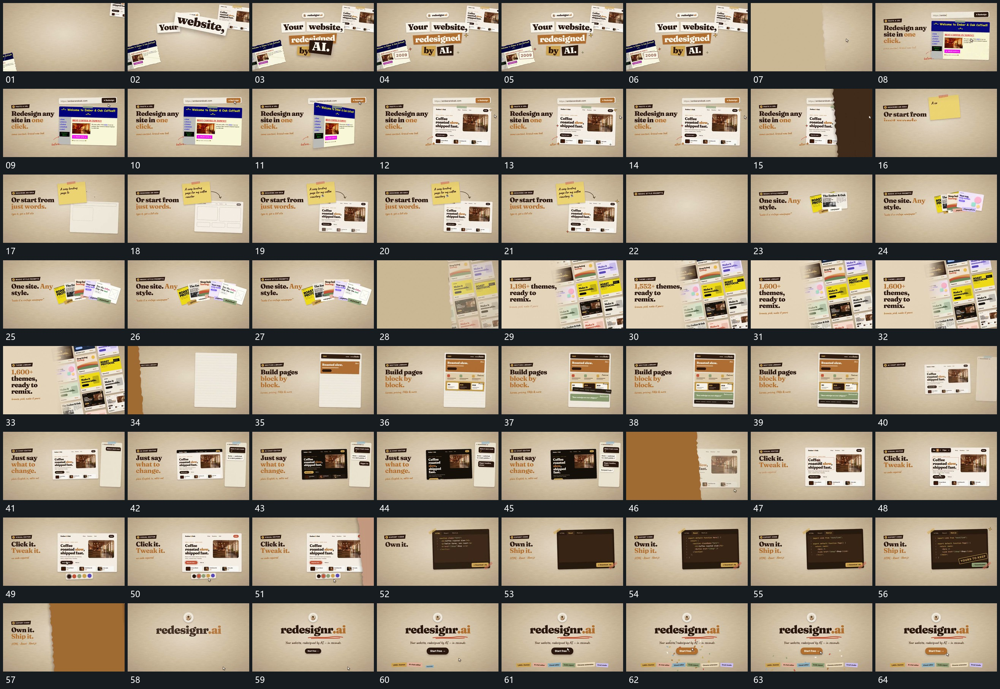

# 029｜原片运动总览

[观看完整原片](video.mp4)

## 运动总览

开头 短字片错开叠入，组成中央完整句组 让短字片错开叠入，中部组形完整后外围片退去。竖向分界换内图，侧方不齐边缘覆盖接替下一组 在同一框面内以竖向分界替换内容，随后不齐边缘的覆盖从侧边经过，换入新布局。

中段 虚线槽逐项建立，内部图文随后补齐 先立空框与虚线槽，再依次补入各区内容。短片扇形展开后满幅倾斜集合接管，数值在旁侧增长。横块从上到下分批落位，固定长片逐段填满 在固定长片上从上到下逐项填入横块，后块接入时前块保持。

之后并置框内内容更新，局部小条接续出现。收尾再次使用 竖向分界换内图，侧方不齐边缘覆盖接替下一组 的边缘覆盖，固定框内文字逐字增加，短线先延长，长条与小标签错开补齐 先画短下划线，再建立长条和下方小标签，短反馈散片退出后保持。

## 完整运动段落

以下按原片中的出现顺序引用。建立、内部发展及完成反馈放在同一段中；同时发生的局部动作与运镜写在同一份指令里。不同段之间可以是连续接管，也可以是直接切换，不能仅凭条目相邻认定可直接拼接。重复出现的同类运动采用一次连续代表范围，切片不以逐段无缝覆盖整片为目标。

1. [短字片错开叠入，组成中央完整句组](mechanisms/m01.md)：字片按层进入，已有项留住

2. [分界扫换内图，侧向覆盖后重新搭槽填满](mechanisms/m06.md)：分界先改变固定图内的内容，再由侧向不齐边缘覆盖交接；新布局先建立空槽，图文随后逐项补齐。

3. [横块从上到下分批落位，固定长片逐段填满](mechanisms/m04.md)：长片固定，每块在自己的空位落稳

4. [短线先延长，长条与小标签错开补齐](mechanisms/m05.md)：线给出稳定起点，附属项随后建立

切片保留起始准备、必要内部停顿和完成或明确交接；首尾省略无新发展的等待，持续运动不要求人为停住。以上基于真实源帧序列和重点边界核对，不等同于全片连续声画审片。

## 完整64宫格

