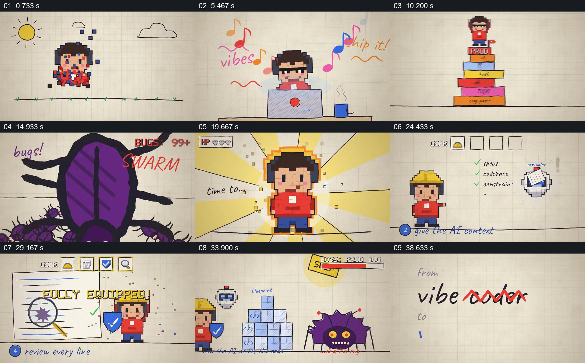

# 用游戏失败和装备升级串起开发习惯的改变

- 作品：案例 083《从盲目发布到有检查的开发》（本次概括）。
- 原片范围：00:00.000–00:42.645，含起点、不含终点；[完整原片](../video.mp4)｜[本卡片段](../video.mp4)。
- 观察方式：依据约每秒一次的真实源帧观察，未连续原速观看或听审；声音、语气与完整播放节奏未确认。

## 原画面具体怎样设计

像素人物在电脑前输入请求，点击 ACCEPT ALL 后纸张飞出，人物乘火箭并出现 SHIPPED。随后代表生产环境的积木起火、出现 ERROR 500 和成群虫子，人物生命值下降。画面提示升级：蓝图、上下文清单、盾牌与放大镜依次出现，人物装备逐步增加；最后面对大虫子，代码方块堆叠，虫子倒下，出现 BUG FIXED 和测试通过，结尾由 vibe coder 改为 vibe engineer。

## 为什么这样设计，好在哪里

游戏生命值、装备和敌人让风险与改进有直观的前后差异；前段的虫子与后段的大虫子共用形象，连接问题和处理结果。代码与测试是图示，不是可复核的真实开发记录。

以上为依据画面的分析，非作者自述；预期观看效果未经观众测试。

## 可直接使用的创意指令

讲工作方法改变时，先用一个具体任务展示未经检查的动作及其后果，再让同一人物逐项获得与风险对应的准备、上下文、验证和审查工具；最后回到原问题展示如何处理并交代可核查结果。若需要证明方法有效，应提供真实任务、错误、修改及测试证据，游戏化图形只承担比喻。
