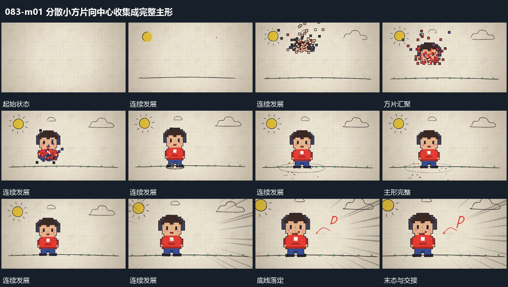

# 分散小方片向中心收集成完整主形

## 运动指令

让小方片从中央周围向内移动，边靠近边对齐到各自位置，使内部先成片、外轮廓随后完整。剩余片退去，形成的主形向下落到共同底线，并在接触附近短促展开细点。

## 视频切片

[播放本机制的原片切片](m01.mp4)

保留起始准备、连续发展和完成或明确交接；首尾按本段运动范围裁切，不拼接、不变速。尾部只保留理解结果所需的展示。

## 分镜过程

## 组合与调整

可改变片数；汇聚结束后保留同一拼成的形，不用完整图形替换尚未收齐的碎片。
