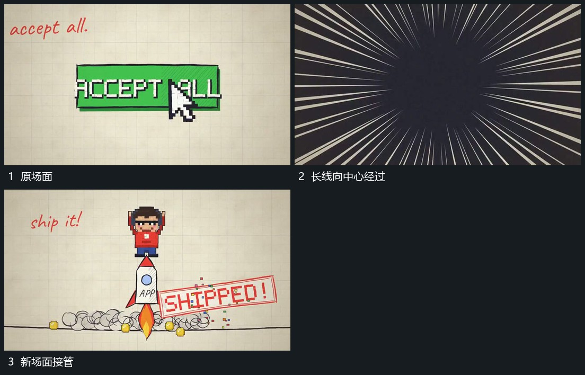

# 放射长线从外围向中心经过并覆盖换场

## 运动指令

围绕同一中心让外围长线朝内快速经过，线的长度随靠近变化，中部覆盖区逐渐扩大并遮住原层。原层被覆盖后让下一场面从同一中心接入，放射方向可以转为向外展开。

## 视频切片

[播放本机制的原片切片](m02.mp4)

覆盖分镜中“原场面”至“新场面接管”的连续过程，并保留邻近的前后衔接画面；原片中交叠发生的动作一并保留。

## 分镜过程

## 组合与调整

接管前后共用中心；线条速度按新片调整，不需要继承原片具体节奏。
