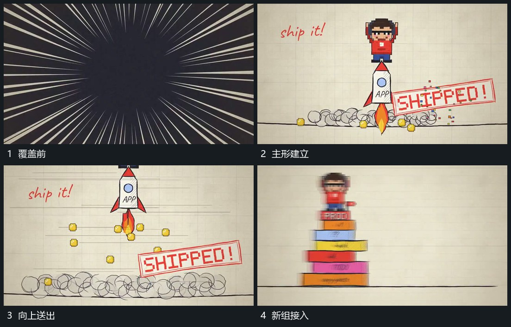

# 细长主形向上送出底部圈与小片散开

## 运动指令

从底线附近让细长主形向上抬起，底端接出向下短带与小片。主形持续上升越出上边，小片向侧下方分散，底线附近圈形逐次展开并退弱，给下一组留出范围。

## 视频切片

[播放本机制的原片切片](m03.mp4)

覆盖分镜中“覆盖前”至“新组接入”的连续过程，并保留邻近的前后衔接画面；原片中交叠发生的动作一并保留。

## 分镜过程

## 组合与调整

可把主形换成任意窄组；底部残留先出现再退，不能随主形同时瞬间消失。
