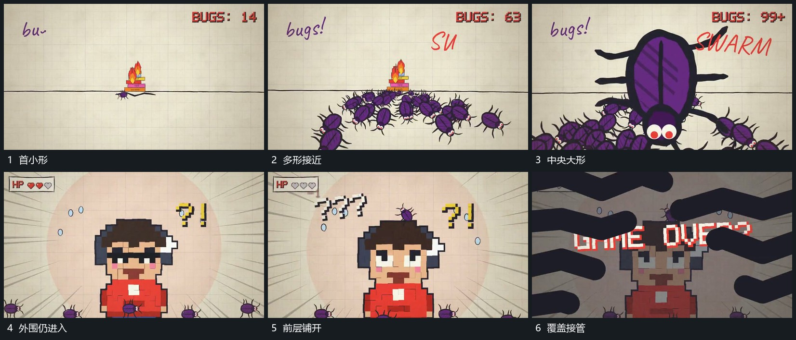

# 多个小形从下缘接近并增大铺向前层

## 运动指令

从下缘与侧下方分次送入多个小形，它们向中央靠近时逐步增大，前后形互相交叠。中央较大形继续向前，外围小形仍补入，直到前层边界越出画面，随后接入覆盖区。

## 视频切片

[播放本机制的原片切片](m04.mp4)

覆盖分镜中“首小形”至“覆盖接管”的连续过程，并保留邻近的前后衔接画面；原片中交叠发生的动作一并保留。

## 分镜过程

## 组合与调整

小形身份可任意替换；层次来自不同位置与尺度变化，避免所有形同时同幅放大。
