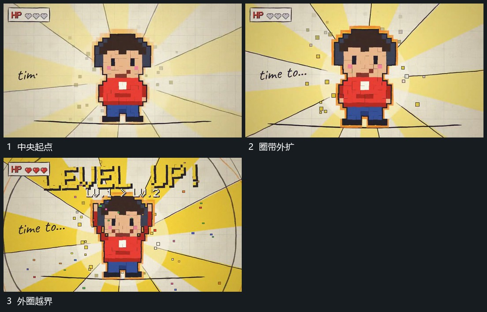

# 中央主形保持接点向外展开圈带并抬起

## 运动指令

围中央主形向外伸展短带与小方片，圆边界随后扩大。主形在扩张中略放大并向上抬起，底线参照不动；外围片层向外经过，结束时收回主形多余位移并保持。

## 视频切片

[播放本机制的原片切片](m05.mp4)

覆盖分镜中“中央起点”至“外圈越界”的连续过程，并保留邻近的前后衔接画面；原片中交叠发生的动作一并保留。

## 分镜过程

## 组合与调整

外圈与主形幅度分别控制；保留底线，避免把全组缩放误当主形抬起。
