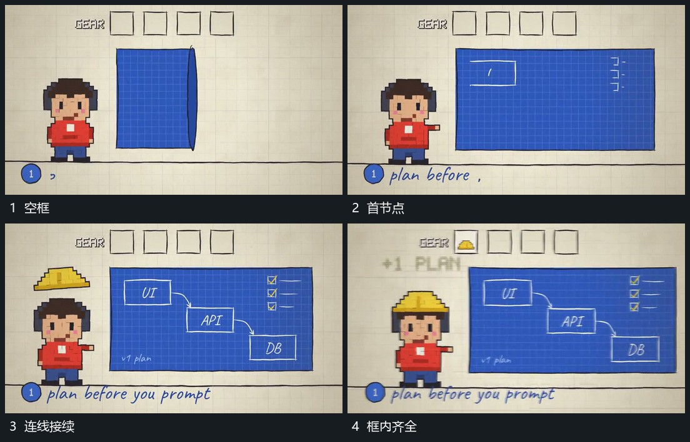

# 框内节点先建立连线逐段接上侧项补齐

## 运动指令

保持大框边界，先在一处建立小节点，再延长曲线到下一节点，下一节点在连接接近时接入。多个连接完成后补侧边短项与确认标记，已有节点和线路保持原位。

## 视频切片

[播放本机制的原片切片](m06.mp4)

覆盖分镜中“空框”至“框内齐全”的连续过程，并保留邻近的前后衔接画面；原片中交叠发生的动作一并保留。

## 分镜过程

## 组合与调整

按表达需要减少节点；连线从已有端点派生，不先铺完整网再闪入所有节点。
