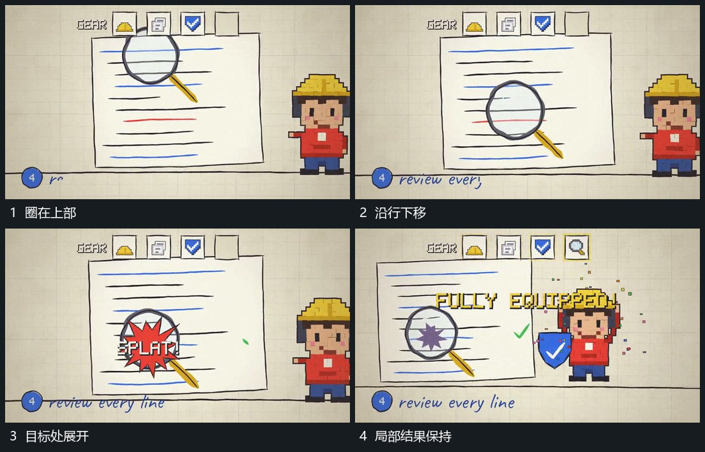

# 圈形指示沿多行移动到目标后局部展开

## 运动指令

让带短柄的圈形沿片面多行改变位置，经过各行时片面保持。到目标附近后停住，小强调形从圈内向外展开，再回收为较小标记；圈和标记共同保留，旁侧小组不动。

## 视频切片

[播放本机制的原片切片](m08.mp4)

覆盖分镜中“圈在上部”至“局部结果保持”的连续过程，并保留邻近的前后衔接画面；原片中交叠发生的动作一并保留。

## 分镜过程

## 组合与调整

移动路径先依行序安排；不要全片摇动来代替局部指示的移动。
