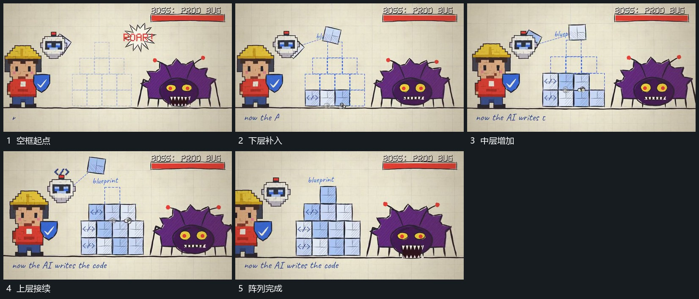

# 方片逐层落入并堆成台阶阵列

## 运动指令

先在底线上建立一排空框，让方片从上方逐次落入并保留。下层完成后在其上增加下一层，层宽逐步收窄，形成台阶阵列。已落入的片不随上层移动，外围组形继续保持。

## 视频切片

[播放本机制的原片切片](m09.mp4)

覆盖分镜中“空框起点”至“阵列完成”的连续过程，并保留邻近的前后衔接画面；原片中交叠发生的动作一并保留。

## 分镜过程

## 组合与调整

可改行列数量；层间落点对齐已有片顶面，不在半空直接堆出整组。
