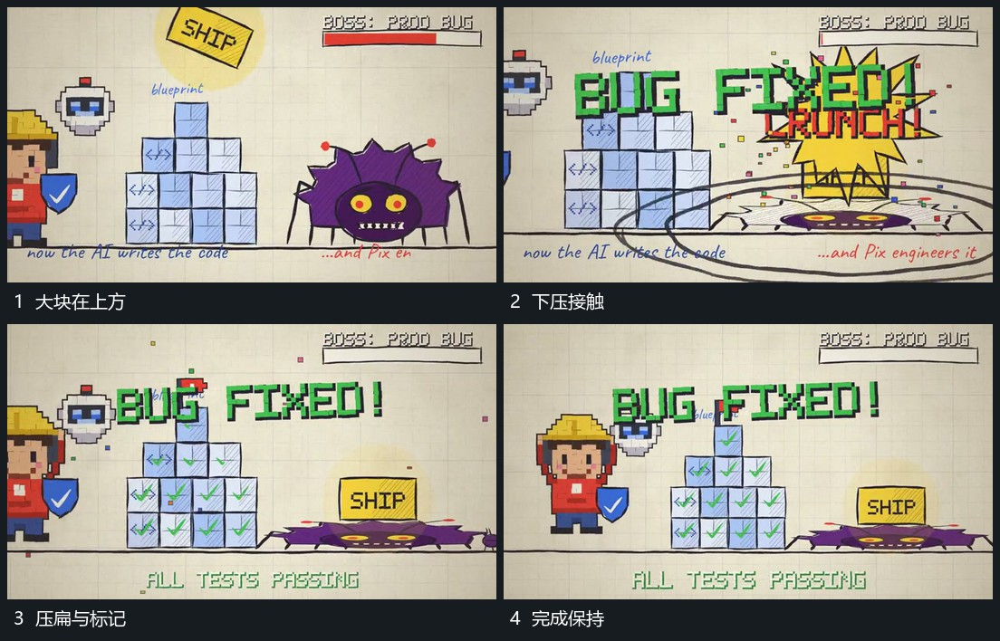

# 大块下压旁形后局部压扁扩散阵列逐项更新

## 运动指令

大块从上方带倾角接近旁形，向下压到其上缘；旁形高度缩小、横向展开，接触处的圈与短线向外扩散。台阶阵列不移动，内部标记由局部到多项接替，完成后大块与压低的旁形保持。

## 视频切片

[播放本机制的原片切片](m10.mp4)

覆盖分镜中“大块在上方”至“完成保持”的连续过程，并保留邻近的前后衔接画面；原片中交叠发生的动作一并保留。

## 分镜过程

## 组合与调整

下压只影响接触层，阵列保持参照；无需声称真实碰撞或物理模拟。
