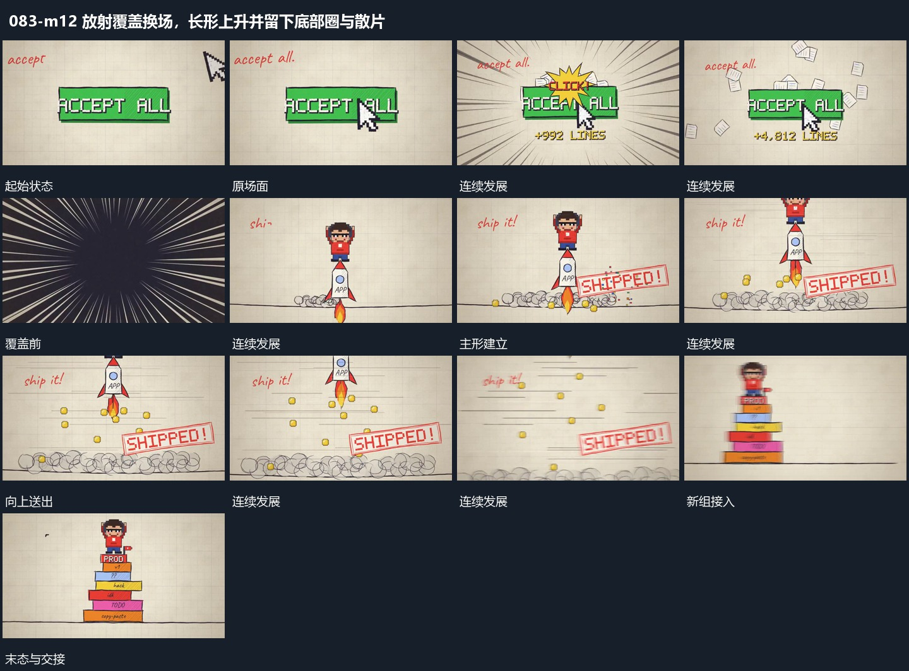

# 放射覆盖换场，长形上升并留下底部圈与散片

## 运动指令

放射长线向中心经过完成覆盖，新场长形向上送出；底部圈和小片随上升扩散，主形越界后留下完成标记。

1. **放射长线从外围向中心经过并覆盖换场**

围绕同一中心让外围长线朝内快速经过，线的长度随靠近变化，中部覆盖区逐渐扩大并遮住原层。原层被覆盖后让下一场面从同一中心接入，放射方向可以转为向外展开。

2. **细长主形向上送出底部圈与小片散开**

从底线附近让细长主形向上抬起，底端接出向下短带与小片。主形持续上升越出上边，小片向侧下方分散，底线附近圈形逐次展开并退弱，给下一组留出范围。

整段结束：主形越出上边且底部圈退去 保留必要落稳与交接，中间已建立的参照沿用到下一步骤。

## 视频切片

[播放本机制的原片切片](m12.mp4)

保留起始准备、连续发展和完成或明确交接；首尾按本段运动范围裁切，不拼接、不变速。相连的小动作合为同一完整段落。

## 分镜过程

## 组合与调整

放射长线向中心经过完成覆盖，新场长形向上送出；底部圈和小片随上升扩散，主形越界后留下完成标记。 复用时可调整元素数量、幅度和相对节奏，保留上述进入、交叠与完成关系；不直接沿用原片题材或时长。

接管前后共用中心；线条速度按新片调整，不需要继承原片具体节奏。

可把主形换成任意窄组；底部残留先出现再退，不能随主形同时瞬间消失。
