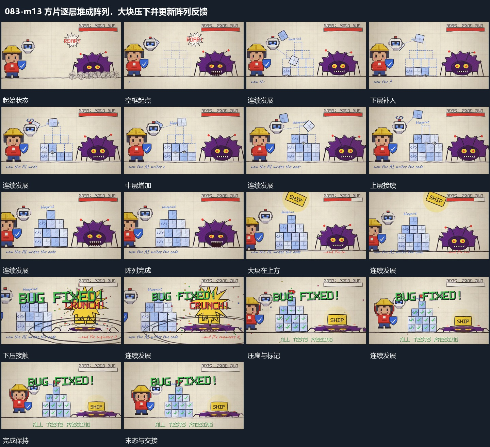

# 方片逐层堆成阵列，大块压下并更新阵列反馈

## 运动指令

方片依次落入、累积为台阶阵列；大块向下压弯后局部外扩，阵列各项接续更新，保留压后结果。

1. **方片逐层落入并堆成台阶阵列**

先在底线上建立一排空框，让方片从上方逐次落入并保留。下层完成后在其上增加下一层，层宽逐步收窄，形成台阶阵列。已落入的片不随上层移动，外围组形继续保持。

2. **大块下压旁形后局部压扁扩散阵列逐项更新**

大块从上方带倾角接近旁形，向下压到其上缘；旁形高度缩小、横向展开，接触处的圈与短线向外扩散。台阶阵列不移动，内部标记由局部到多项接替，完成后大块与压低的旁形保持。

整段结束：旁形压低且阵列标记齐全 保留必要落稳与交接，中间已建立的参照沿用到下一步骤。

## 视频切片

[播放本机制的原片切片](m13.mp4)

保留起始准备、连续发展和完成或明确交接；首尾按本段运动范围裁切，不拼接、不变速。相连的小动作合为同一完整段落。

## 分镜过程

## 组合与调整

方片依次落入、累积为台阶阵列；大块向下压弯后局部外扩，阵列各项接续更新，保留压后结果。 复用时可调整元素数量、幅度和相对节奏，保留上述进入、交叠与完成关系；不直接沿用原片题材或时长。

可改行列数量；层间落点对齐已有片顶面，不在半空直接堆出整组。

下压只影响接触层，阵列保持参照；无需声称真实碰撞或物理模拟。
