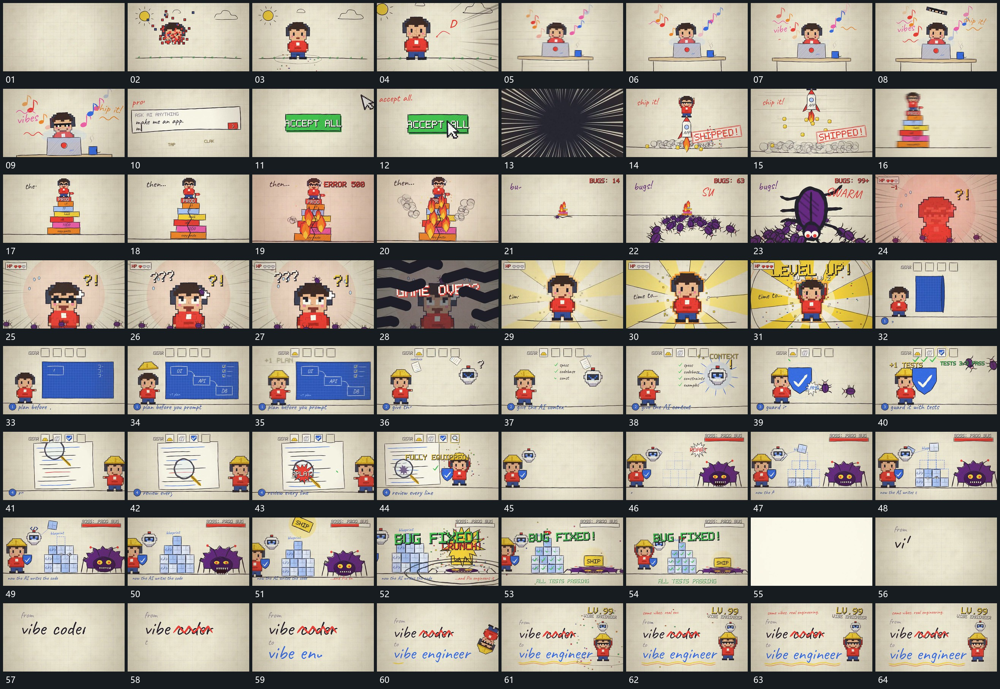

# 083｜原片运动总览

[观看完整原片](video.mp4)

## 运动总览

全片先用分散小方片向中心收集成完整主形把分散小方片收成完整主形，接到稳定底层与多项外围变化。中央局部推近后，以放射长线从外围向中心经过并覆盖换场的放射线覆盖换场，细长主形向上送出底部圈与小片散开把细长主形向上送出并在下方留下扩散圈。

下一组由多块叠起，多个小形从下缘接近并增大铺向前层让多个小形从下缘接近、增大并铺向前层，再用放射长线从外围向中心经过并覆盖换场覆盖接管。中心新主形由中央主形保持接点向外展开圈带并抬起向外展开圈带并抬起。中段框内节点先建立连线逐段接上侧项补齐在大框中补节点、连线与侧项；旁侧薄片分次靠近中心留下累积条目让旁侧片面分次向中心靠近，接上圈形指示沿多行移动到目标后局部展开的圈形指示移动与局部强调。

后段方片逐层落入并堆成台阶阵列将方片逐层叠成阵列，大块下压旁形后局部压扁扩散阵列逐项更新让大块下压旁形并带动局部压扁、扩散和逐项更新。结尾短行描入划过局部再接下行与旁形先描短行再划掉局部，接入下行和旁形，保持完整结果。

## 完整运动段落

以下按原片中的出现顺序引用。建立、内部发展及完成反馈放在同一段中；同时发生的局部动作与运镜写在同一份指令里。不同段之间可以是连续接管，也可以是直接切换，不能仅凭条目相邻认定可直接拼接。重复出现的同类运动采用一次连续代表范围，切片不以逐段无缝覆盖整片为目标。

1. [分散小方片向中心收集成完整主形](mechanisms/m01.md)：收集拼合后落定

2. [放射覆盖换场，长形上升并留下底部圈与散片](mechanisms/m12.md)：放射长线向中心经过完成覆盖，新场长形向上送出；底部圈和小片随上升扩散，主形越界后留下完成标记。

3. [多个小形从下缘接近并增大铺向前层](mechanisms/m04.md)：边缘进入不断放大

4. [中央主形保持接点向外展开圈带并抬起](mechanisms/m05.md)：外扩与抬起交叠

5. [框内节点先建立连线逐段接上侧项补齐](mechanisms/m06.md)：节点先立连线后接

6. [旁侧薄片分次靠近中心留下累积条目](mechanisms/m07.md)：多片靠近逐项保留

7. [圈形指示沿多行移动到目标后局部展开](mechanisms/m08.md)：沿行移位后局部强调

8. [方片逐层堆成阵列，大块压下并更新阵列反馈](mechanisms/m13.md)：方片依次落入、累积为台阶阵列；大块向下压弯后局部外扩，阵列各项接续更新，保留压后结果。

9. [短行描入划过局部再接下行与旁形](mechanisms/m11.md)：描字划线新行接入

切片保留起始准备、必要内部停顿和完成或明确交接；首尾省略无新发展的等待，持续运动不要求人为停住。以上基于真实源帧序列和重点边界核对，不等同于全片连续声画审片。

## 完整64宫格

