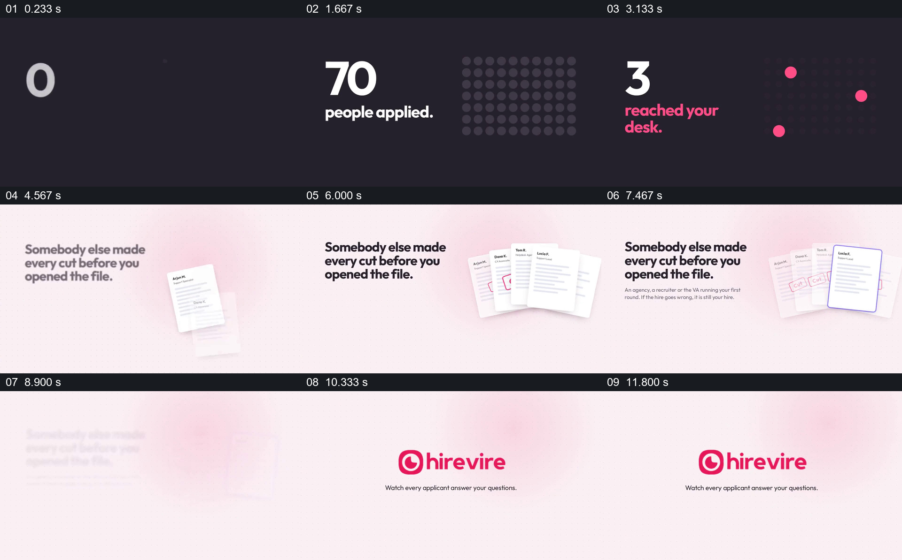

# 用人数组合与简历选择，把筛选结果变成可见问题

- 作品：案例 010《手机录音与人物视频窗口》（库内索引名）。
- 原片范围：00:00.000–00:13.000，含起点、不含终点；[完整原片](../video.mp4)｜[本卡片段](c01.mp4)。片段起点对应原片 0.000 秒。
- 范围依据：筛选数量、简历结果与品牌共同完成问题建立；随后转入配置。
- 观察方式：核看整片 64 帧总览和本卡九宫格；原片没有音轨。未独立完成连续原速观看，精确动作和停顿待核；迁移尚未实测。以下价值判断属于作品分析，片中界面、人物、数据和商业条件未独立查证。

## 原画面具体怎样设计

深色底上左侧数字从 0 显示到“70 people applied”，右侧排布许多灰色圆点。随后左侧变成“3 reached your desk”，右侧只有三个粉色点醒目。画面换到浅粉背景，左侧出现“Somebody else made every cut before you opened the file”，右侧多张简历扇形叠放；几张上有“Cut”印记，一张以紫色边框突出。最后简历和说明退去，画面中心出现 Hirevire 标识和“Watch every applicant answer your questions”。

## 为什么这样设计，好在哪里

点阵把抽象人数转换成可以比较的多少，随后一叠简历使筛选的对象具体化；两段都指向“提交者多、最终到桌面的人少”的观看问题。品牌直到问题建立后才成为中心。片中 70 与 3、简历及筛选结论是示例画面，未独立证实，不能当作真实统计。

## 完整照排指令

以[完整原片](../video.mp4)的 0–13 秒为准。画幅 1280×720，源帧率 30/1。以下拍点为抽帧定位，位置按画幅百分比取近似值。

### 用料

- 【报名总数】【送达数】【报名短注】【送达短注】取同一次筛选，送达名单可追溯到报名集合。若声称实际数量，附可打开的报表或留有日期、筛选口径的资料；点阵为示意时明确其用途。
- 【简历组】【选中简历】取经授权的同一批材料或明确标注的演示文档，选中项必须是前面扇形组内的一份。遮去无需公开的个人信息，但留足纸面结构。【筛选主句】【筛选副句】写可由材料支撑的短句，另备【品牌标识】【品牌副句】【邻段标题】【邻段页面】。

### 按源时刻摆放

1. **0.000–约 2.000 秒。** 炭黑紫底满铺。左侧在上半用大号白粗数字从零升至【报名总数】，其下小一档白色【报名短注】。右半细圆点随计数扩成矩阵，暗灰，列距紧。不要让点阵侵入数字区。
2. **约 2.000–4.000 秒。** 矩阵内先亮出少量粉点，集中在不同位置。随后灰点退尽，只剩可认出源位置的亮粉点。左侧大白换【送达数】，下方用粉色小粗【送达短注】分两行。人数变化与点阵收缩属于同一拍：先指出子集，再显示送达数，禁用另一批随机点冒充筛选结果。点为图层动画，无需视频。
3. **约 4.000–8.500 秒。** 浅灰粉色擦过深底。左上以深色粗【筛选主句】左齐三至四行，稍后下方补小灰【筛选副句】。右侧放【简历组】，白纸薄阴影，页片由靠前位置逐张展开成轻微左右倾斜的扇形。末拍淡去其他页，保留【选中简历】较清楚，细边线使其从邻页分出。选中页应从组内原位突出，前页仍短暂可见。文档允许静态照片运镜，各页需使用对应材料。
4. **约 8.500–10.500 秒。** 文案及页组整体退，浅粉底中央落粉红【品牌标识】，下方接小深色【品牌副句】。保持中轴，静态留读。
5. **约 10.500–13.000 秒。** 品牌淡尽，左上换【邻段标题】，右上或下方补低亮说明，浅色【邻段页面】从下部建立并拉近到表项。按 13.000 秒切出；若新片只采用筛选质问，可在邻段首帧前截止。

### 局部采用

只有同口径统计可取 0–约 4 秒。只有授权的前后文档与选中关系可采用约 4–8.500 秒，不在画中补填猜测人数。

### 验证状态

已对照原片每秒两帧画序并读回。核对灰点先成矩阵、亮点出现后再收成子集、简历扇形与原位选中，以及品牌后接流程页。精确切帧、原速听看与换料试摆待核。
