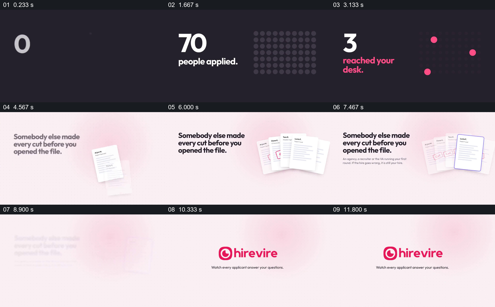

# 用申请人数与少数入选点形成筛选落差

- 作品：案例 010《手机录音与人物视频窗口》（索引名称）。
- 原片范围：00:00.000–00:13.000，含起点、不含终点；[完整原片](../video.mp4)｜[本卡片段](c01.mp4)。
- 观察方式：依据整片 64 宫格和约每秒一次的真实源帧观察，未连续原速观看；媒体探测显示原片没有音轨，因此没有可听审的原声。

## 原画面具体怎样设计

深色背景中，申请人数随圆点阵列增加，随后数字转成“3 reached your desk.”，阵列只留下三个粉色亮点。浅色场景里，一叠简历旁写着“Somebody else made every cut before you opened the file.”，部分纸张上出现标记，一张简历被描边；随后出现 hirevire 标识。

## 为什么这样设计，好在哪里

用同一组点从多到少，使数量落差能被直接看见；简历和文案补出中间筛选发生的位置，产品标识再接住问题。圆点是示意，片中的申请人数和筛选结论没有独立来源。

以上为依据画面的分析，非作者自述；预期观看效果未经观众测试。

## 可直接使用的创意指令

当确需说明一批对象经过筛选后只剩少数时，先用经过核实的总数与同口径的可视元素建立群体，再突出最终留下的对象；接入真实的文件或工作界面，说明由谁、依据什么发生了筛选，再引出后续处理。若筛选过程没有证据，只把缩减作为待解释问题，不把示意点阵当作统计证明。
