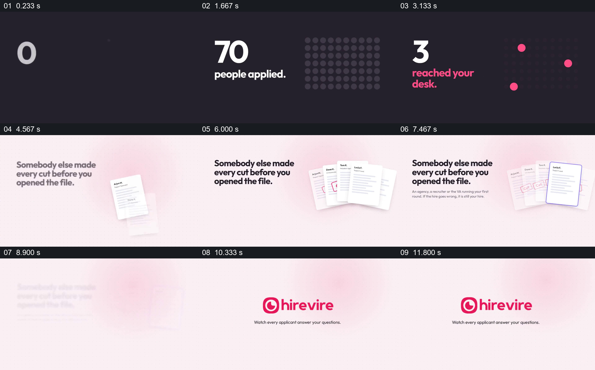

# 用人数组合与简历选择，把筛选结果变成可见问题

- 作品：案例 010《手机录音与人物视频窗口》（库内索引名）。
- 原片范围：00:00.000–00:13.000，含起点、不含终点；[完整原片](../video.mp4)｜[本卡片段](c01.mp4)。片段起点对应原片 0.000 秒。
- 范围依据：筛选数量、简历结果与品牌共同完成问题建立；随后转入配置。
- 观察方式：核看整片 64 帧总览和本卡九宫格；原片没有音轨。未独立完成连续原速观看，精确动作和停顿待核；迁移尚未实测。以下价值判断属于作品分析，片中界面、人物、数据和商业条件未独立查证。

## 原画面具体怎样设计

深色底上左侧数字从 0 显示到“70 people applied”，右侧排布许多灰色圆点。随后左侧变成“3 reached your desk”，右侧只有三个粉色点醒目。画面换到浅粉背景，左侧出现“Somebody else made every cut before you opened the file”，右侧多张简历扇形叠放；几张上有“Cut”印记，一张以紫色边框突出。最后简历和说明退去，画面中心出现 Hirevire 标识和“Watch every applicant answer your questions”。

## 为什么这样设计，好在哪里

点阵把抽象人数转换成可以比较的多少，随后一叠简历使筛选的对象具体化；两段都指向“提交者多、最终到桌面的人少”的观看问题。品牌直到问题建立后才成为中心。片中 70 与 3、简历及筛选结论是示例画面，未独立证实，不能当作真实统计。

## 可直接使用的创意指令

确有需要解释的筛选过程时，准备同口径的初始数量、结果数量及能辨认的被筛对象。先让全部对象形成集合，再以显著颜色或其他编码显示进入下一阶段的少数；接着通过具体材料解释筛选发生在什么对象上，最后引出应对方案。保留数量与对象之间的对应；点阵、颜色和简历形式可改。没有真实依据时明确为模拟示例。
