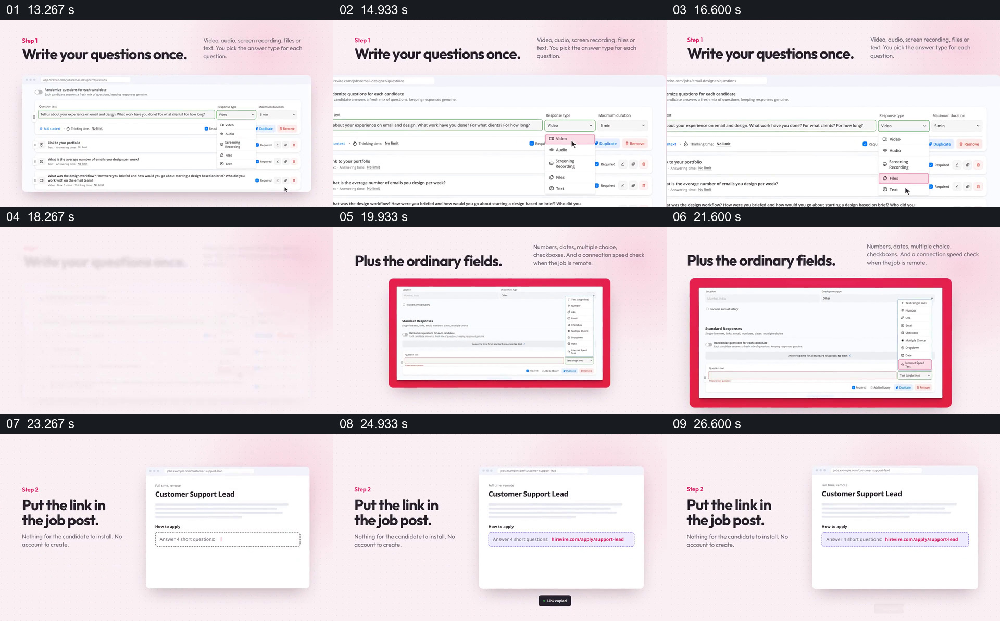

# 在配置问题后，把链接放进职位页面

- 作品：案例 010《手机录音与人物视频窗口》（索引名称）。
- 原片范围：00:13.000–00:28.000，含起点、不含终点；[完整原片](../video.mp4)｜[本卡片段](c02.mp4)。
- 观察方式：依据整片 64 宫格和约每秒一次的真实源帧观察，未连续原速观看；媒体探测显示原片没有音轨，因此没有可听审的原声。

## 原画面具体怎样设计

“Write your questions once.”旁显示问题列表及回答类型下拉选择，画面放大到具体字段；随后“Plus the ordinary fields.”旁展示普通字段列表。接着标题改为“Put the link in the job post.”，职位页面中的链接位置被强调并保留。

## 为什么这样设计，好在哪里

每个短句都对应可见界面，使观众能从设置位置跟到分发位置；同一浅色背景和界面比例保持了工作流连续性。原片界面演示说明的是作品中呈现的流程，不证明当前产品实际支持所有选项。

以上为依据画面的分析，非作者自述；预期观看效果未经观众测试。

## 可直接使用的创意指令

当需要解释先配置内容、再让受众进入某个流程时，以真实界面或明确标注的示意界面展示关键问题及可选字段，局部放大操作位置并保留结果；接着展示发布载体，在清晰可读的区域突出入口链接。优先保留会影响后续回答的设置，实际字段、权限与功能按当前产品核对。
