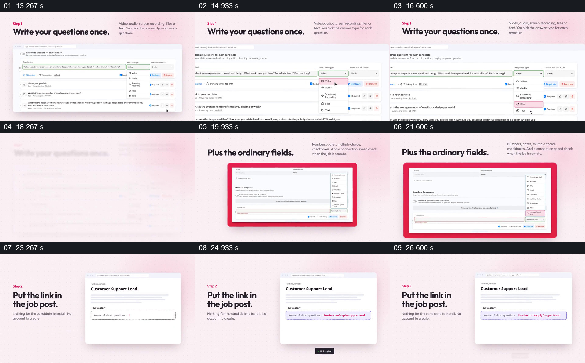

# 先展示问题设置，再把同一流程接到职位页面的链接

- 作品：案例 010《手机录音与人物视频窗口》（库内索引名）。
- 原片范围：00:13.000–00:28.000，含起点、不含终点；[完整原片](../video.mp4)｜[本卡片段](c02.mp4)。片段起点对应原片 13.000 秒。
- 范围依据：配置、字段与链接放置共同说明输入至入口；随后开始录制。
- 观察方式：核看整片 64 帧总览和本卡九宫格；原片没有音轨。未独立完成连续原速观看，精确动作和停顿待核；迁移尚未实测。以下价值判断属于作品分析，片中界面、人物、数据和商业条件未独立查证。

## 原画面具体怎样设计

浅粉背景上左上写“Step 1 / Write your questions once”，下方是多条问题的配置界面，右上小字介绍视频、音频、屏幕录制、文件和文字类型。界面局部变大，回答类型下拉框成为中心；随后另一张带粉色边框的页面展示普通字段列表。约 00:23，版式改为左侧“Step 2 / Put the link in the job post”，右侧招聘页面有职位名称与“How to apply”区域，申请链接出现于该区域并以颜色突出。

## 为什么这样设计，好在哪里

先看后台输入，再看对外页面上的位置，观众能把“配置什么”与“对方从哪里进入”连成一个过程。问题类型和普通字段分两次突出，减少同屏的阅读负担；之后左侧步骤标题保持入口解释，右侧页面成为具体载体。此处所有界面和功能为原片演示。

## 完整照排指令

以[完整原片](../video.mp4)的 13–28 秒为准。画幅 1280×720，源帧率 30/1。以下拍点为抽帧定位，位置按画幅百分比取近似值。

### 用料

【问题设置页】【普通字段页】【职位页面】【填写链接】【手机接拍】取同一职位或演示项目，保留问题选项、一般字段和链接目标的对应。备【步骤一标题】【步骤一说明】【步骤二标题】【步骤二说明】【步骤三标题】【步骤三说明】【手机标题】。使用实际流程时附可打开的职位或保存的源页、表单地址以及操作记录；用演示记录遮住个人信息。

### 按源时刻摆放

1. **13.000–约 18.000 秒。** 暖白底带右上粉晕。左上以小粉步骤眉字、粗黑单行【步骤一标题】，右上放低亮【步骤一说明】。下部近满宽白【问题设置页】，保持轻阴影和列表行的水平基线。渐推页面直到左右列表去到画边，但上方标题不要跟着放大。问题类型在列表右半以浅彩签和控件露出，粉色薄框短暂描出正在选择的位置。窗内从建立到让位持续演示，可用同一真实截图分层切选项，勿换成另一份表单。
2. **约 18.000–22.000 秒。** 旧页面和标题短淡退。保留暖粉背景，左上【步骤二标题】与右上【步骤二说明】取代原题。中央白【普通字段页】缩为约八成宽，外侧包鲜粉矩形厚边，粉框由淡至实。表单内左侧浅灰线与文字，右侧窄列中逐次框出普通字段；新框出现时原字段页仍留在原位。
3. **约 22.000–27.000 秒。** 亮粉外框淡去。左面两行黑粗【步骤三标题】，下方两行小灰【步骤三说明】，右侧较大的白【职位页面】用真实段落填充。初始让页面主体成立，再将【填写链接】作为细长一行显现在正文中部，粉或蓝紫标识跟随它，只在需要时在白页下方留一个小深状态提示。选中前后保持同一职位标题和版面，链接必须通向前两拍所配置的入口。
4. **约 27.000–28.000 秒。** 职位页淡退，左边换【手机标题】，右下立起竖向【手机接拍】并露暖色人像录制画面。按 28.000 秒接出。若只采用配置和发布，结束在手机进入前。

### 局部采用

只有字段配置可用 13–约 22 秒；只有职位和同源表单链接则可用约 22–27 秒。若链接目标无法核对，只呈现明确的演示界面。

### 验证状态

已对照原片每秒两帧画序并读回，核对列表局部放大、粉框标普通字段、职位页原位显示链接及手机切入。指示框精确帧、原速听看与换料试摆待核。
