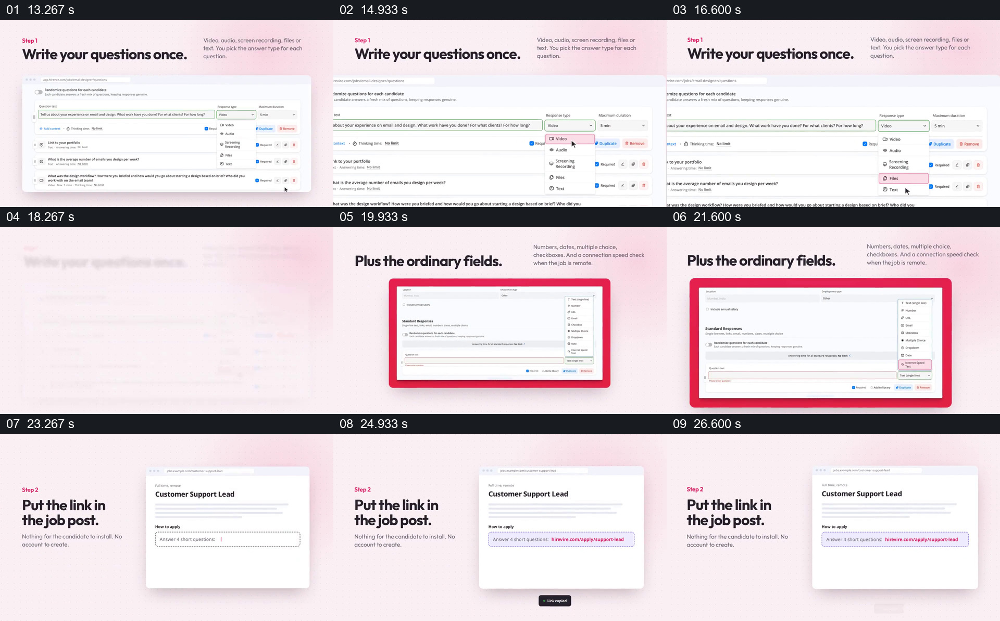

# 先展示问题设置，再把同一流程接到职位页面的链接

- 作品：案例 010《手机录音与人物视频窗口》（库内索引名）。
- 原片范围：00:13.000–00:28.000，含起点、不含终点；[完整原片](../video.mp4)｜[本卡片段](c02.mp4)。片段起点对应原片 13.000 秒。
- 范围依据：配置、字段与链接放置共同说明输入至入口；随后开始录制。
- 观察方式：核看整片 64 帧总览和本卡九宫格；原片没有音轨。未独立完成连续原速观看，精确动作和停顿待核；迁移尚未实测。以下价值判断属于作品分析，片中界面、人物、数据和商业条件未独立查证。

## 原画面具体怎样设计

浅粉背景上左上写“Step 1 / Write your questions once”，下方是多条问题的配置界面，右上小字介绍视频、音频、屏幕录制、文件和文字类型。界面局部变大，回答类型下拉框成为中心；随后另一张带粉色边框的页面展示普通字段列表。约 00:23，版式改为左侧“Step 2 / Put the link in the job post”，右侧招聘页面有职位名称与“How to apply”区域，申请链接出现于该区域并以颜色突出。

## 为什么这样设计，好在哪里

先看后台输入，再看对外页面上的位置，观众能把“配置什么”与“对方从哪里进入”连成一个过程。问题类型和普通字段分两次突出，减少同屏的阅读负担；之后左侧步骤标题保持入口解释，右侧页面成为具体载体。此处所有界面和功能为原片演示。

## 可直接使用的创意指令

需要讲解一个真实流程时，选能说明配置结果的界面和接收者实际使用的入口。先建立配置页面并突出关键字段，再只放大必要的选项；随后切到接收者所见的页面，让入口出现在有上下文的位置，保持步骤标签与页面内容的对应。界面与媒介可以替换；不可丢失输入与入口的明确关系。功能未实现时标注演示。
