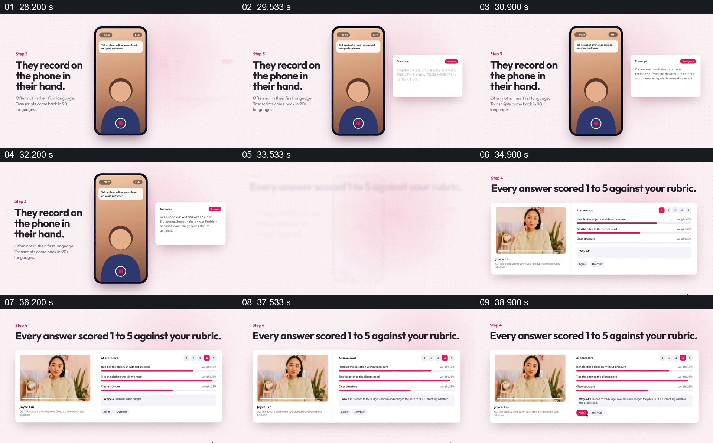

# 手机回答与转录并列，再回到人物和评分

- 作品：案例 010《手机录音与人物视频窗口》（索引名称）。
- 原片范围：00:28.000–00:40.000，含起点、不含终点；[完整原片](../video.mp4)｜[本卡片段](c03.mp4)。
- 观察方式：依据整片 64 宫格和约每秒一次的真实源帧观察，未连续原速观看；媒体探测显示原片没有音轨，因此没有可听审的原声。

## 原画面具体怎样设计

左侧写“They record on the phone in their hand.”，中间手机显示人物图形及录制按钮，右边的转录卡依次更新文字。随后出现“Every answer scored 1 to 5 against your rubric.”，人物视频位于左侧，右侧评分项目和红色条形陆续建立。

## 为什么这样设计，好在哪里

手机、文字与人物视频分别承担回答入口、可读内容和原回答的作用；评分条与人物视频并排，让评价仍有可回看的对象。画面没有提供足够依据核实转录准确性、评分有效性或自动化责任归属。

以上为依据画面的分析，非作者自述；预期观看效果未经观众测试。

## 可直接使用的创意指令

当要说明一次回答如何进入后续评估，准备获授权的回答内容、对应的可读转录和经确认的评分规则。先并列呈现录制入口与文字变化，再把同一回答的人物画面与评价项目放在一起，清楚标出谁制定规则、谁给出分数及是否需要复核。保持回答可回看，不以演示图或条形长度冒充真实评估结果。
