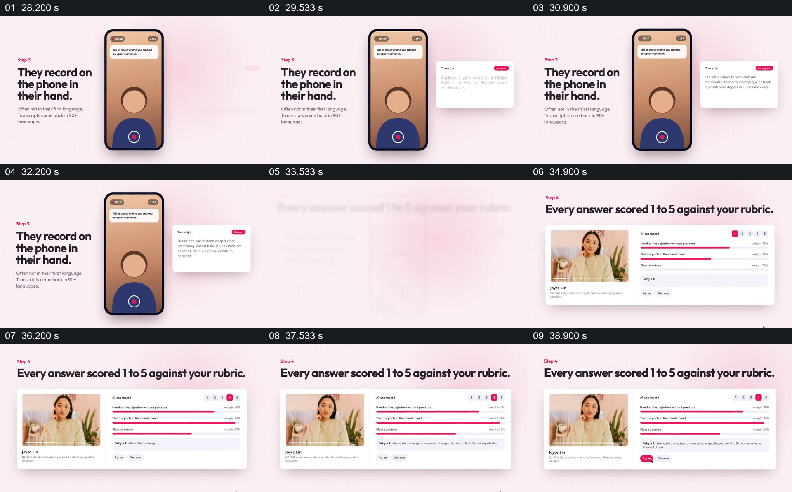

# 从手机回答与多语言文字，交到人物视频和评分面板

- 作品：案例 010《手机录音与人物视频窗口》（库内索引名）。
- 原片范围：00:28.000–00:40.000，含起点、不含终点；[完整原片](../video.mp4)｜[本卡片段](c03.mp4)。片段起点对应原片 28.000 秒。
- 范围依据：手机录制、转写与评分结果共同构成采集到查看；随后转入分享。
- 观察方式：核看整片 64 帧总览和本卡九宫格；原片没有音轨。未独立完成连续原速观看，精确动作和停顿待核；迁移尚未实测。以下价值判断属于作品分析，片中界面、人物、数据和商业条件未独立查证。

## 原画面具体怎样设计

左侧是“Step 3 / They record on the phone in their hand”，中间手机内为简化人物形象、问题文字和录制按钮；右侧出现标有语言的 Transcript 卡片，源帧中可见日语、葡语、德语等不同文本。约 00:34 画面换成“Step 4”标题及横向评分卡：左边为女性回答视频窗口，右边是 1–5 分选择和三条粉色评价条，下方有说明及 Agree、Overrule 按钮。电话示意与后面的视频并未在抽帧中证明属于同一人。

## 为什么这样设计，好在哪里

手机说明回答发生在哪里，旁侧文本卡让原片声称的多语言结果有具体载体；换到评分卡后，人物影像和评价条并置，使内容与判断在同一个视觉单元内。若只有评分，没有视频，观众难以知道评价指向谁；若同时塞入所有语言及指标，阅读重心会散开。界面评分及语言能力均未独立验证。

## 可直接使用的创意指令

当流程有真实的采集内容与后续查看结果，先用可辨认的设备或场景建立采集对象，再在邻近区域展示与内容对应的记录；需要展示多种语言或格式时分次替换，保留共同载体。随后将内容与评价或处理结果并置，明确评价对象与标准。记录格式、设备与布局可改；不把模拟评分当成真实评价，也不暗示未核实的内容身份。
