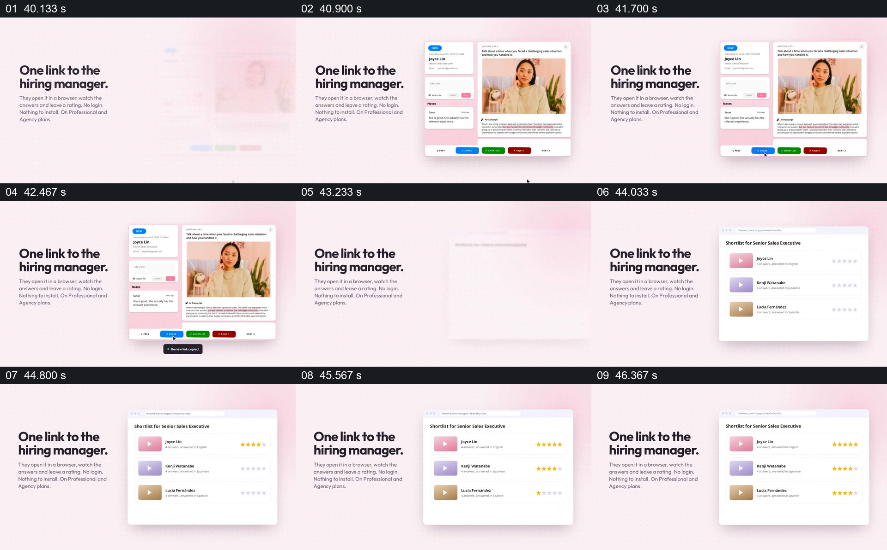

# 把一个候选人的详情收束成可分享短名单

- 作品：案例 010《手机录音与人物视频窗口》（索引名称）。
- 原片范围：00:40.000–00:47.000，含起点、不含终点；[完整原片](../video.mp4)｜[本卡片段](c04.mp4)。
- 观察方式：依据整片 64 宫格和约每秒一次的真实源帧观察，未连续原速观看；媒体探测显示原片没有音轨，因此没有可听审的原声。

## 原画面具体怎样设计

左侧写“One link to the hiring manager.”，右侧是包含人物视频、文字和操作按钮的候选人详情页；随后右侧页面切成多个候选人的短名单，每行有缩略图、姓名和星级。左侧说明区域保持，读者的关注从单个回答转向多人的比较。

## 为什么这样设计，好在哪里

先看具体候选人，再看汇总清单，说明被分享的不只是单个片段，而是可继续比较和回看的材料集合。共同标题维持交接对象，单项与列表的尺度变化帮助区分查看和决策。

以上为依据画面的分析，非作者自述；预期观看效果未经观众测试。

## 可直接使用的创意指令

当需要把一项调查、回答或作品交给后续决策者时，先呈现一份能回到原内容的详情及明确的分享入口，再以同一批对象组成简洁列表，保留必要的身份、可追溯入口与经核实的评价信息。将决策权和隐私权限说清；列表排序或星级不能代替完整依据。
