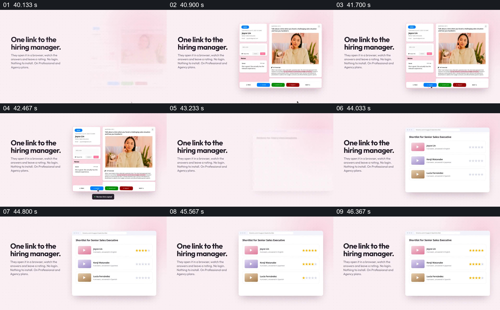

# 让人物详情页通过分享入口接到可比较的候选列表

- 作品：案例 010《手机录音与人物视频窗口》（库内索引名）。
- 原片范围：00:40.000–00:47.000，含起点、不含终点；[完整原片](../video.mp4)｜[本卡片段](c04.mp4)。片段起点对应原片 40.000 秒。
- 范围依据：详情、分享反馈与短名单完成交接；随后转为功能列表。
- 观察方式：核看整片 64 帧总览和本卡九宫格；原片没有音轨。未独立完成连续原速观看，精确动作和停顿待核；迁移尚未实测。以下价值判断属于作品分析，片中界面、人物、数据和商业条件未独立查证。

## 原画面具体怎样设计

左侧标题“One link to the hiring manager”，右侧为候选人详情页：人物视频在右上，姓名、备注与转写文本分布在周围，底部有 Share、Shortlist、Reject 等按钮。源帧中蓝色 Share 被指向，出现“Review link copied”提示；随后详情页淡出，左侧标题维持，右侧变成三行候选短名单，每行有视频入口、名字及星级，星星逐步着色。

## 为什么这样设计，好在哪里

先看一个人的完整信息，再看到可分享的多行列表，使“单项详情”和“接收者比较多项”分别有自己的阅读层级。左侧说明贯穿页面更替，观众不必重新寻找当前流程目的。短名单和星级是演示界面，不能由此推断真实筛选、公平性或评分有效性。

## 可直接使用的创意指令

当需要说明内容从单项进入协作查看时，先展示可识别的单项信息及明确交接入口，再让入口产生可读的反馈；随后展示接收方看到的集合，每项保留识别、查看和必要比较信息。保持文字任务或其他稳定参照贯穿交接，布局和按钮可按产品修改；列表的排序、评分及权限必须对应实际系统，不以模拟画面当作已执行操作。
