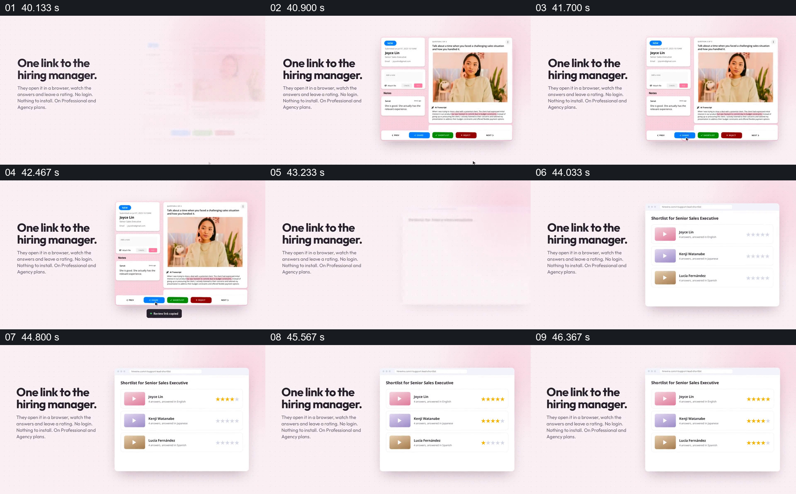

# 让人物详情页通过分享入口接到可比较的候选列表

- 作品：案例 010《手机录音与人物视频窗口》（库内索引名）。
- 原片范围：00:40.000–00:47.000，含起点、不含终点；[完整原片](../video.mp4)｜[本卡片段](c04.mp4)。片段起点对应原片 40.000 秒。
- 范围依据：详情、分享反馈与短名单完成交接；随后转为功能列表。
- 观察方式：核看整片 64 帧总览和本卡九宫格；原片没有音轨。未独立完成连续原速观看，精确动作和停顿待核；迁移尚未实测。以下价值判断属于作品分析，片中界面、人物、数据和商业条件未独立查证。

## 原画面具体怎样设计

左侧标题“One link to the hiring manager”，右侧为候选人详情页：人物视频在右上，姓名、备注与转写文本分布在周围，底部有 Share、Shortlist、Reject 等按钮。源帧中蓝色 Share 被指向，出现“Review link copied”提示；随后详情页淡出，左侧标题维持，右侧变成三行候选短名单，每行有视频入口、名字及星级，星星逐步着色。

## 为什么这样设计，好在哪里

先看一个人的完整信息，再看到可分享的多行列表，使“单项详情”和“接收者比较多项”分别有自己的阅读层级。左侧说明贯穿页面更替，观众不必重新寻找当前流程目的。短名单和星级是演示界面，不能由此推断真实筛选、公平性或评分有效性。

## 完整照排指令

以[完整原片](../video.mp4)的 40–47 秒为准。画幅 1280×720，源帧率 30/1。以下拍点为抽帧定位，位置按画幅百分比取近似值。

### 用料

【人物详情】【候选列表】【分享链接】来自同一个招聘批次。详情中的人物须能在列表用姓名、头像或编号找回。备【分享标题】【分享说明】【分享反馈】【列表标题】【候选字段】【筛选短句组】。使用授权样例，真实评分提供可核对出处及统一量表。

### 按源时刻摆放

1. **40.000–约 43.000 秒。** 浅白粉渐变底。左半粗黑【分享标题】两行，其下浅灰【分享说明】。右半白色圆角【人物详情】，左列细信息，右列暖色视频回放，底部蓝绿红控件横排。小暗【分享反馈】在控件下短暂露出，显示【分享链接】对应的动作。回放从本段开头至详情页退出保持连续；若只示意分享，可用同一答复的封面静帧。
2. **约 43.000–45.600 秒。** 左侧标题与说明仍在原位。右窗内容整体让位给同尺度浅色【候选列表】，保留标签栏并先排【列表标题】、首行候选，再逐行加入另两位。各行左侧粉、紫或棕色头像块，中间浅黑【候选字段】，右侧同一基线排黄星或评分。已进场的行一直留到列表退场。首位应能对应前拍详情，使用相同批次和可比较的评价口径。可用静态行分层淡入。
3. **约 45.600–47.000 秒。** 整版收去，背景仍浅粉白。横向小组【筛选短句组】依次移过中央左齐，现读句黑粗，邻句低亮淡灰。按 47.000 秒切出，若只要分享和列表，在短句接管前切。

### 局部采用

只有可确认的详情与分享记录，可用 40–约 43 秒。只有同口径列表，可用约 43–45.600 秒，沿用前段解释其来源。

### 验证状态

已对照逐秒原片画序并读回正文，核对左文保留、详情换列表后逐行累积、末拍短句接管。精确切点、窗内运动和换料试摆待核。
