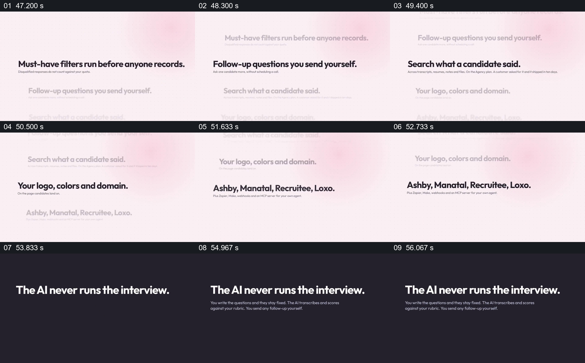

# 滚动展示功能清单，最后用深色页面声明责任

- 作品：案例 010《手机录音与人物视频窗口》（索引名称）。
- 原片范围：00:47.000–00:57.000，含起点、不含终点；[完整原片](../video.mp4)｜[本卡片段](c05.mp4)。
- 观察方式：依据整片 64 宫格和约每秒一次的真实源帧观察，未连续原速观看；媒体探测显示原片没有音轨，因此没有可听审的原声。

## 原画面具体怎样设计

浅粉背景上的多条短句依次处在清晰位置，包括筛选、追问、搜索回答、品牌颜色与平台名称等；前一项变淡后，下一项成为视觉重点。之后背景切深色，大字写“The AI never runs the interview.”，下方较小文字说明问题由人编写、AI 转录和评分等。

## 为什么这样设计，好在哪里

一次只强调一行，降低了长清单同时争夺注意的压力；深色页面与前面的浅色清单分开，让责任边界成为独立重点。具体产品职责与真实性未核查，不能把画面中的断言当作普遍规则。

以上为依据画面的分析，非作者自述；预期观看效果未经观众测试。

## 可直接使用的创意指令

当一组能力需要附带责任边界时，把确已核实且对受众重要的能力逐项放在固定阅读位置，保持已出现信息有足够时间；随后用明显不同的层级说明哪些环节由人负责、哪些由系统处理以及必要的复核方式。内容过多时分组或另附资料，不用快速滚动取代可读性。
