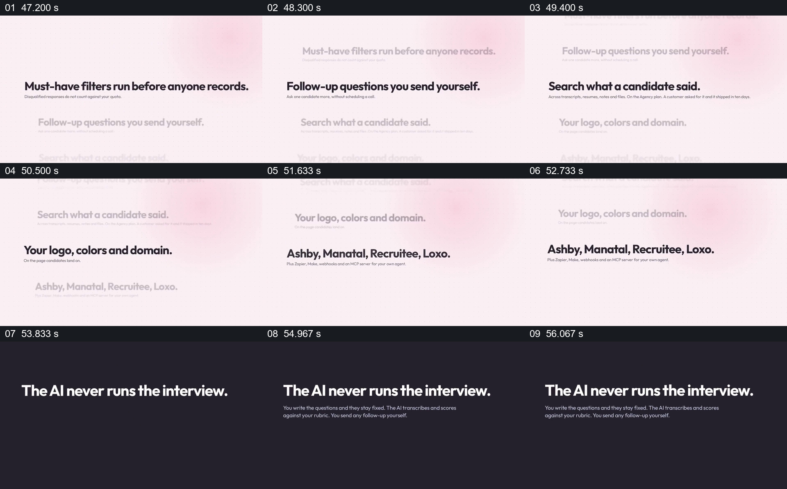

# 用逐项聚焦的功能列表，接到单独突出的一句边界

- 作品：案例 010《手机录音与人物视频窗口》（库内索引名）。
- 原片范围：00:47.000–00:57.000，含起点、不含终点；[完整原片](../video.mp4)｜[本卡片段](c05.mp4)。片段起点对应原片 47.000 秒。
- 范围依据：功能列表与使用边界共同完成说明；随后转入价格。
- 观察方式：核看整片 64 帧总览和本卡九宫格；原片没有音轨。未独立完成连续原速观看，精确动作和停顿待核；迁移尚未实测。以下价值判断属于作品分析，片中界面、人物、数据和商业条件未独立查证。

## 原画面具体怎样设计

浅粉背景中数条功能短句上下排列：当前一项为深色，其余项以浅灰呈现；不同时刻的源帧中焦点依次落在筛选、追问、搜索、品牌与集成说明。随后画面转深色，中心偏左单独出现“The AI never runs the interview.”，其下较小文字说明用户编写问题、系统转写和评分、追问由用户发送。

## 为什么这样设计，好在哪里

列表通过对比度而非多个不同屏幕标示阅读顺序，观众既看到当前项，也知道还有其他项。深色背景使最后一句从一串功能里独立出来，给原片所声称的工作分工更高的视觉权重。每项都是广告主张，视觉层级不能证明功能或责任边界真实成立。

## 可直接使用的创意指令

当有数项并列功能及一项必须明确的使用边界时，先压缩每项为可以独立阅读的短句，按阅读顺序轮流提高当前项对比度，同时保留相邻项作为位置参照；随后让列表退出，把经过核实的边界单独置于清楚的画面上，并提供必要解释。颜色、排列和焦点方式可重设；保留列表与关键边界的主次关系。
