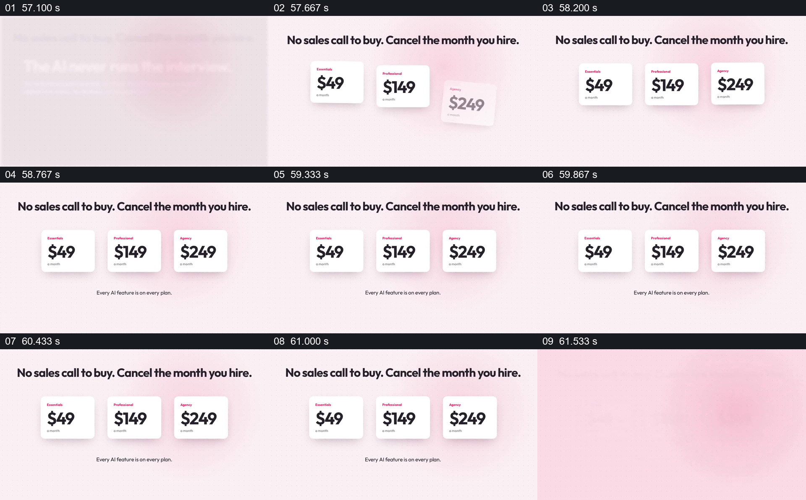

# 把三种价格放在同一阅读层，再保留共同条件

- 作品：案例 010《手机录音与人物视频窗口》（库内索引名）。
- 原片范围：00:57.000–01:02.000，含起点、不含终点；[完整原片](../video.mp4)｜[本卡片段](c06.mp4)。片段起点对应原片 57.000 秒。
- 范围依据：三个价格与共同条件完成比较；之后是品牌和试用片尾。
- 观察方式：核看整片 64 帧总览和本卡九宫格；原片没有音轨。未独立完成连续原速观看，精确动作和停顿待核；迁移尚未实测。以下价值判断属于作品分析，片中界面、人物、数据和商业条件未独立查证。

## 原画面具体怎样设计

浅色背景上方显示“No sales call to buy. Cancel the month you hire.”；下方三张白色卡片依次形成一排，分别写 Essentials $49、Professional $149、Agency $249，均标有每月。卡片高度、文字布局和间距相近，没有某一张占据主要面积；最后一行“Every AI feature is on every plan”出现在卡片下方，价格与共同条件同时可见。

## 为什么这样设计，好在哪里

统一尺寸与计价单位让注意力集中于方案和价格的区别，单独放在下方的共同条件避免重复写在每张卡里；最终三项并列可供横向比较。此处价格、功能及取消条件为片中展示，并非本次核实的现行报价。

## 可直接使用的创意指令

展示真实可比较的选项时，先统一价格或指标的计量单位和适用周期，让各方案在同一视觉层级中出现；把各项的主要差异放在相同位置，再将确实共同适用的条件放在集合附近，并保留足够阅读时间。卡片数量、颜色、排序和背景可调整；不要隐藏重要差异或把过期资料作为现行报价。
